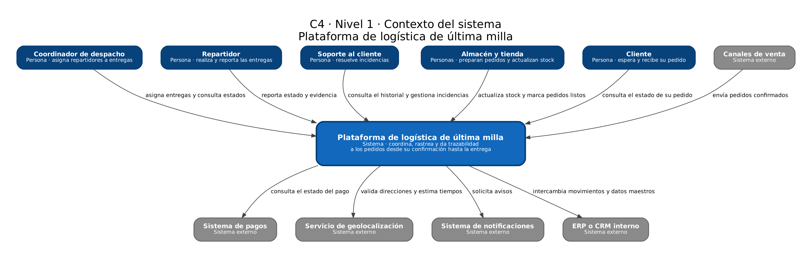
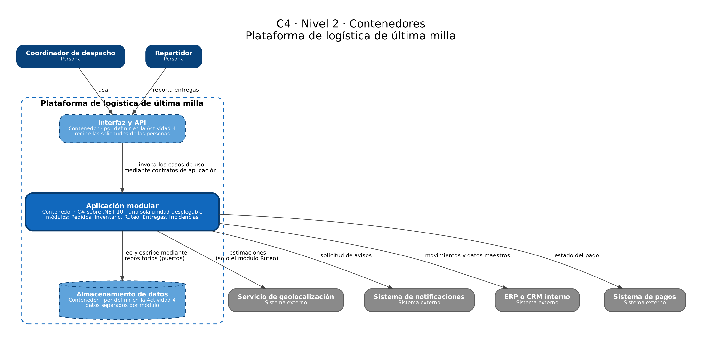
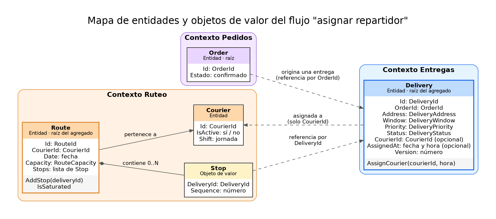
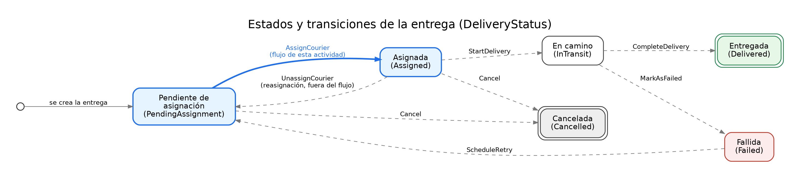

# Arquitectura de la plataforma de logística de última milla

| Campo | Valor |
|-------|-------|
| **Estado** | Vigente tras la Actividad 3 |
| **Última actualización** | Noviembre de 2026 |
| **Autor** | [Tu nombre completo] |
| **Alcance** | Plataforma de gestión logística de última milla para una empresa de retail digital |

## 1. Propósito de este documento

Este documento describe la arquitectura de la plataforma: qué problema resuelve, cómo se organiza, dónde están sus límites y por qué se tomaron las decisiones principales. Está pensado para que cualquier persona que llegue al proyecto comprenda la estructura sin necesidad de leer todo el código.

No reemplaza a los documentos de cada actividad, sino que los resume y los conecta. Cuando una explicación se desarrolla con más detalle en otro lugar, se indica el enlace.

> Este documento describe lo **diseñado y decidido**. La persistencia, la interfaz y las integraciones reales corresponden a la Actividad 4 y se señalan como pendientes.

## 2. Contexto y problema

La empresa recibe pedidos por varios canales, maneja inventarios distribuidos y coordina entregas con distintas rutas y repartidores, pero no cuenta con una vista única del estado real de cada pedido. Esto genera pedidos duplicados, inventario inconsistente, entregas retrasadas o fallidas y pérdida de trazabilidad (`docs/actividad-1/01-analisis-del-problema.md`).

**Objetivo de la plataforma:** coordinar, rastrear y dar trazabilidad a los pedidos de última milla, desde que están confirmados hasta que llegan al cliente.

**Fuera de su alcance:** cobrar pagos, administrar el catálogo, vender en los canales, operar la bodega, calcular mapas, enviar mensajes y emitir facturas (`docs/actividad-1/03-alcance.md`).

## 3. Decisiones arquitectónicas principales

| Decisión | Resumen | Registro |
|----------|---------|----------|
| **Plataforma centralizada** | Una única plataforma coordina los pedidos, en lugar de que cada área conserve su propia información | `docs/actividad-1/06-supuestos-y-decisiones.md` (D01) |
| **Monolito modular con límites de dominio** | Una sola unidad desplegable, organizada en módulos por dominio, con interfaces explícitas entre ellos | `docs/actividad-2/adr/ADR-001-estructura-de-la-plataforma.md` |
| **Convivencia con el ERP/CRM** | La plataforma se integra con el sistema existente y no lo reemplaza | `docs/actividad-1/06-supuestos-y-decisiones.md` (D06) |
| **Tres capas con dependencias hacia adentro** | Dominio, aplicación e infraestructura, con puertos y adaptadores | `docs/actividad-3/adr/ADR-003-capas-y-dependencias.md` |
| **Coordinación entre Entregas y Ruteo** | Reserva previa del cupo con liberación compensatoria | `docs/actividad-3/adr/ADR-004-coordinacion-entre-entregas-y-ruteo.md` |
| **Rechazos de negocio como resultados** | Códigos estables en lugar de excepciones; evento registrado tras guardar; aviso que no revierte la asignación | `docs/actividad-3/adr/ADR-005-rechazos-eventos-y-avisos.md` |
| **C# sobre .NET 10 para el esqueleto de diseño** | Solo el lenguaje y la plataforma; no se eligen aún bases de datos ni proveedores | `docs/actividad-3/adr/ADR-002-lenguaje-y-plataforma-del-esqueleto.md` |
| **Fuente de la verdad del inventario** | Decisión aplazada hasta contar con información del negocio | Pendiente |


## 4. Vista de contexto (C4, nivel 1)



La plataforma se relaciona con cinco tipos de persona y cinco sistemas externos. El detalle de los actores y sus necesidades está en `docs/actividad-1/02-actores-y-necesidades.md`.

| Interlocutor | Qué intercambia con la plataforma |
|--------------|-----------------------------------|
| Coordinador de despacho | Asigna entregas y consulta estados |
| Repartidor | Reporta estado y evidencia de entrega |
| Soporte al cliente | Consulta el historial y gestiona incidencias |
| Almacén y tienda | Actualizan stock y marcan pedidos listos |
| Cliente | Consulta el estado de su pedido |
| Canales de venta | Envían los pedidos confirmados |
| Sistema de pagos | Informa el estado del pago |
| Servicio de geolocalización | Valida direcciones y estima tiempos |
| Sistema de notificaciones | Entrega los avisos que la plataforma solicita |
| ERP o CRM interno | Intercambia movimientos y datos maestros |

## 5. Vista de contenedores (C4, nivel 2)



| Contenedor | Responsabilidad | Estado |
|------------|-----------------|--------|
| **Aplicación modular** | Contiene toda la lógica del negocio, organizada en los módulos Pedidos, Inventario, Ruteo, Entregas e Incidencias | Esqueleto diseñado y probado |
| **Interfaz y API** | Recibe las solicitudes de las personas y las traduce a casos de uso | Por definir en la Actividad 4 |
| **Almacenamiento de datos** | Guarda los datos de cada módulo, separados entre sí | Por definir en la Actividad 4 |

Por tratarse de un monolito modular, todos los módulos se despliegan juntos. La separación entre ellos es **lógica**, no física: se logra con límites de contexto, interfaces y reglas de dependencia, y deja abierto extraer **Ruteo** como servicio independiente si las condiciones de revisión del ADR-001 lo justifican.

## 6. Módulos y límites de contexto


| Contexto | Responsabilidad | Es dueño de |
|----------|-----------------|-------------|
| **Entregas** | Ciclo de vida de cada entrega | `Delivery` y sus reglas |
| **Ruteo** | Repartidores, rutas, disponibilidad y capacidad | `Route`, `Courier` |
| **Pedidos** | Solicitud de compra y su confirmación | `Order` |
| **Inventario** | Existencias y reservas | `StockReservation` |
| **Incidencias** | Novedades y reclamos | `Incident` |
| **Historial de eventos** | Registro de lo que ocurre con cada pedido | `EventLog` |

Cada contexto tiene su propio modelo y su propio lenguaje. Una misma palabra, como "disponible" o "asignado", significa cosas distintas en cada uno (`docs/actividad-3/02-lenguaje-ubicuo.md`).

**Reglas entre contextos:**

1. Se comunican solo mediante contratos explícitos y versionados.
2. Ningún contexto accede a los datos de otro.
3. Los objetos de otros contextos se referencian solo por su identificador.
4. Cada frontera traduce el lenguaje del vecino mediante una capa anticorrupción.

## 7. Capas y dirección de las dependencias


| Capa | Contiene | Depende de |
|------|----------|------------|
| **Domain** | Entidades, objetos de valor, invariantes, eventos y errores de dominio | Nada |
| **Application** | Casos de uso, contratos de entrada y salida, y puertos | Domain |
| **Infrastructure** | Adaptadores que implementan los puertos | Application |

La aplicación define lo que necesita (el puerto) y la infraestructura lo implementa (el adaptador). Esta regla está reforzada por la estructura de proyectos: el dominio no referencia a ningún otro proyecto, la aplicación referencia solo al dominio y la infraestructura referencia solo a la aplicación. Una dependencia en sentido contrario no compilaría.

## 8. Vista de componentes (C4, nivel 3)


La vista muestra el flujo diseñado en la Actividad 3: **asignar un repartidor a una entrega**.

1. El caso de uso `AssignCourierUseCase` recibe el comando y carga la entrega mediante el puerto del repositorio.
2. Consulta la disponibilidad del repartidor mediante el puerto de Ruteo.
3. Invoca `Delivery.AssignCourier`, donde el dominio protege sus invariantes.
4. Reserva el cupo en la ruta; `Route` protege la capacidad.
5. Guarda la entrega y, si hay un conflicto, libera el cupo.
6. Registra el evento `DeliveryAssigned` y solicita el aviso al repartidor.

El detalle del flujo, los contratos y los puertos está en `docs/actividad-3/06-casos-de-uso-puertos-adaptadores.md`.

## 9. Modelo de dominio



| Concepto | Tipo | Contexto |
|----------|------|----------|
| `Delivery` | Entidad, raíz de agregado | Entregas |
| `Route` | Entidad, raíz de agregado | Ruteo |
| `Courier` | Entidad | Ruteo |
| `DeliveryAddress`, `DeliveryWindow`, `DeliveryPriority`, `DeliveryStatus` | Objetos de valor | Entregas |
| `RouteCapacity`, `Stop` | Objetos de valor | Ruteo |
| `DeliveryAssigned` | Evento de dominio | Entregas |

La entrega pasa por seis estados (pendiente de asignación, asignada, en camino, entregada, fallida y cancelada) con transiciones controladas por la propia entidad.



**Reglas que siempre se cumplen** (`docs/actividad-3/04-invariantes-y-escenarios.md`):

| Regla | La protege |
|-------|------------|
| Una entrega no tiene más de un repartidor activo | `Delivery` |
| Solo se asigna una entrega pendiente | `Delivery` |
| El estado y el repartidor son coherentes | `Delivery` |
| Una ruta no supera su capacidad | `Route` |
| Los objetos de valor no existen en estado inválido | Cada objeto de valor |
| Toda asignación deja un registro: quién, qué y cuándo | `Delivery` y la aplicación |

## 10. Contratos entre contextos

| Contrato | De → A | Tipo | Qué comunica |
|----------|--------|------|--------------|
| **C1** `OrderConfirmed` | Pedidos → Entregas | Evento | Un pedido quedó confirmado |
| **C2** `CourierAvailability` | Entregas → Ruteo | Consulta | ¿Puede este repartidor recibir otra entrega? |
| **C3** Reserva de parada | Entregas → Ruteo | Comando | Reservar o liberar un cupo en la ruta |
| **C4** `DeliveryAssigned` | Entregas → Historial | Evento | A una entrega se le asignó un repartidor |
| **C5** Solicitud de aviso | Entregas → Notificaciones | Comando | Avisar al repartidor |

Los contratos están versionados y describen lo que viaja, no cómo. Su definición completa está en `docs/actividad-3/05-contextos-y-contratos.md`.

## 11. Cualidades y cómo se verifican

| Cualidad | Cómo se logra en esta arquitectura | Escenario |
|----------|------------------------------------|-----------|
| **Consistencia de datos** | La reserva y el estado se coordinan en una sola operación; el control de versión evita dobles escrituras | QS01 |
| **Trazabilidad** | Cada asignación genera un evento con quién, qué y cuándo | QS04 |
| **Evolución** | Un cambio de regla de ruteo toca un solo módulo | QS13 |
| **Resiliencia ante terceros** | Si falla un tercero, la operación continúa; el aviso fallido no revierte la asignación | QS09 |
| **Operabilidad** | Una sola unidad desplegable para un equipo pequeño | QS14 |
| **Facilidad de prueba** | Las reglas del negocio se prueban sin base de datos ni servicios externos | Pruebas del proyecto |

Los criterios para comprobar que la decisión sigue siendo válida están en `docs/actividad-2/05-criterios-verificables.md`.

## 12. Riesgos y puntos abiertos

| Punto | Estado |
|-------|--------|
| **Fuente de la verdad del inventario** entre la plataforma y el ERP/CRM | Abierto, aplazado hasta contar con información del negocio |
| **Persistencia real** y su control de concurrencia | Actividad 4 |
| **Garantía de que el evento no se pierda** si falla su registro tras guardar la entrega | Actividad 4 |
| **Acoplamiento circular** entre Entregas y Ruteo | Controlado con un paquete de contratos por contexto |
| **Degradación del monolito modular** en una base de código acoplada | Controlada con las reglas de dependencia y las revisiones de CE02 |
| **Ruteo bajo carga** | Se vigila con las condiciones de revisión del ADR-001 |

El registro completo de riesgos está en `docs/actividad-1/05-riesgos.md`.

## 13. Estructura del repositorio

```
logistica-ultima-milla/
├── README.md
├── Architecture.md
├── Directory.Build.props
├── docs/
│   ├── actividad-1/   Diagnóstico y contexto
│   ├── actividad-2/   Requisitos y decisión estructural (incluye el ADR-001)
│   └── actividad-3/   Dominio y diseño (incluye los ADR-002 a ADR-005)
├── src/
│   ├── Domain/
│   ├── Application/
│   └── Infrastructure/
└── tests/
    ├── Domain.Tests/
    ├── Application.Tests/
    └── Integration.Tests/
```

## 14. Cómo construir y probar

Requisito: SDK de .NET 10. Desde la raíz del repositorio:

```bash
dotnet build
dotnet test
```

Las pruebas del dominio y de la aplicación no necesitan base de datos ni servicios externos. Las de integración usan adaptadores en memoria.

## 15. Índice de documentación

| Actividad | Documentos |
|-----------|------------|
| **1. Diagnóstico y contexto** | Análisis del problema, actores, alcance, diagrama de contexto, riesgos, supuestos y decisiones |
| **2. Requisitos y decisión estructural** | Catálogo de requisitos, matriz de priorización, escenarios de calidad, comparación de alternativas, criterios verificables y ADR-001 |
| **3. Dominio y diseño** | Flujo de negocio, lenguaje ubicuo, modelo de dominio, invariantes y escenarios, contextos y contratos, casos de uso, puertos y adaptadores, y los ADR-002 a ADR-005 |
