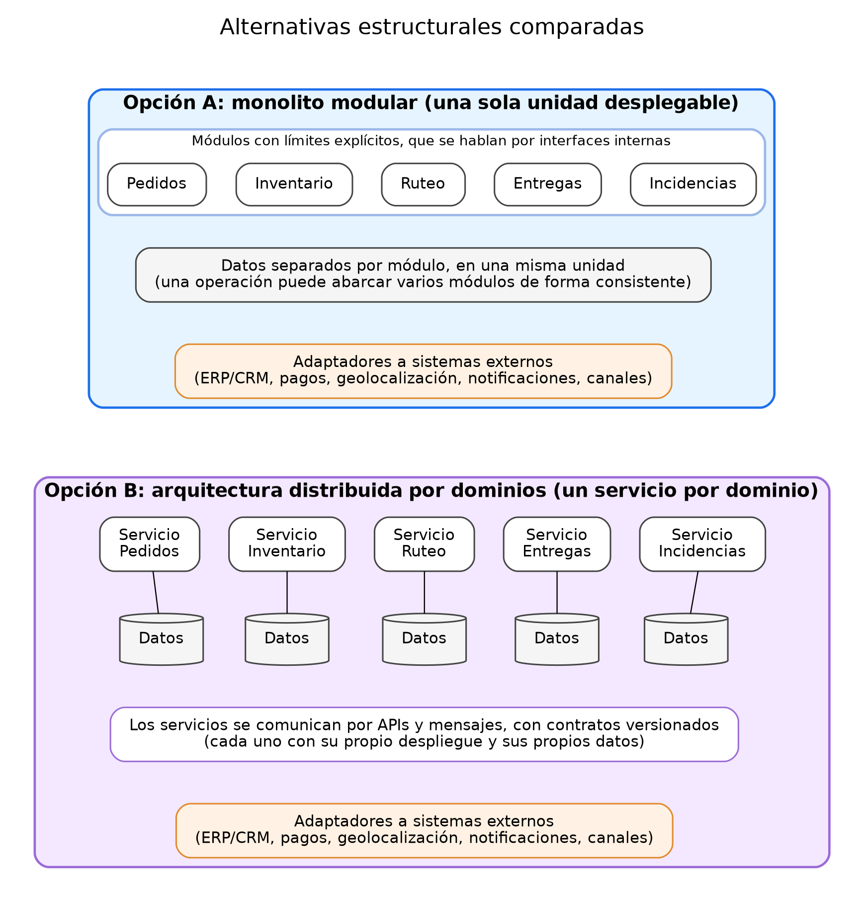
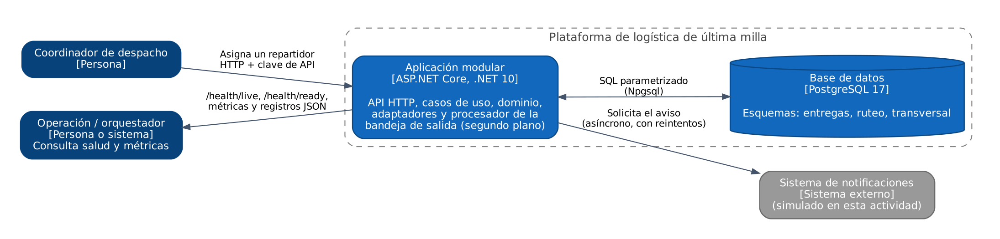
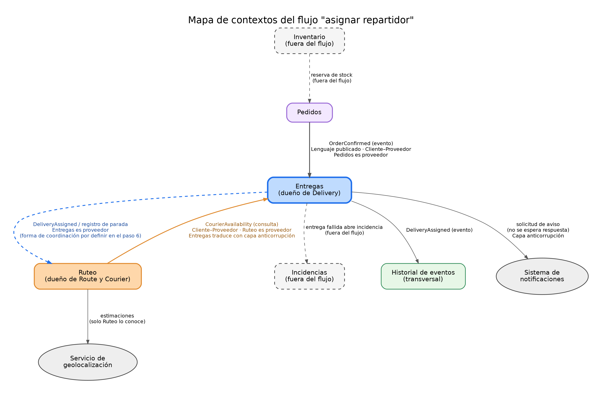
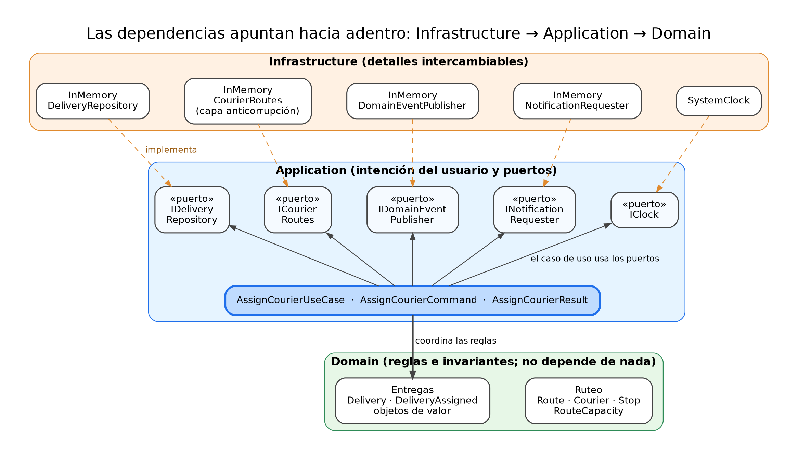
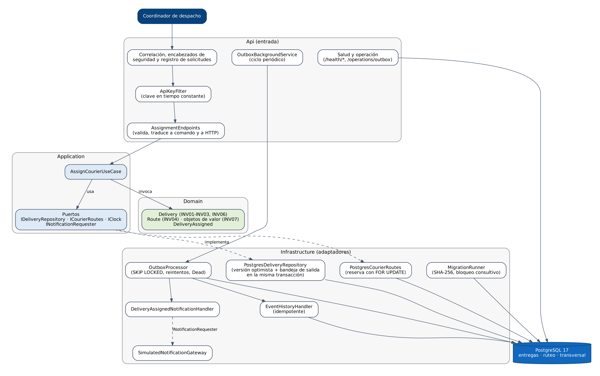
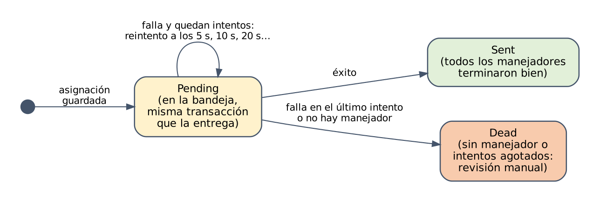

# Arquitectura de la plataforma de logística de última milla

| Campo | Valor |
|-------|-------|
| **Estado** | Vigente tras la Actividad 4 |
| **Última actualización** | Noviembre de 2026 |
| **Autor** | [Tu nombre completo] |
| **Alcance** | Plataforma de gestión logística de última milla para una empresa de retail digital |

## 1. Propósito de este documento

Este documento describe la arquitectura de la plataforma: qué problema resuelve, cómo se organiza, dónde están sus límites y por qué se tomaron las decisiones principales. Está pensado para que cualquier persona que llegue al proyecto comprenda la estructura sin necesidad de leer todo el código.

No reemplaza a los documentos de cada actividad, sino que los resume y los conecta. Cuando una explicación se desarrolla con más detalle en otro lugar, se indica el enlace.

> Este documento describe lo **diseñado, decidido e implementado**. El flujo "asignar un repartidor a una entrega" funciona de punta a punta como un vertical slice ejecutable (Actividad 4). Lo que se simula (el sistema de notificaciones) y lo que sigue abierto se señala de forma explícita.

## 2. Contexto y problema

La empresa recibe pedidos por varios canales, maneja inventarios distribuidos y coordina entregas con distintas rutas y repartidores, pero no cuenta con una vista única del estado real de cada pedido. Esto genera pedidos duplicados, inventario inconsistente, entregas retrasadas o fallidas y pérdida de trazabilidad (`docs/actividad-1/01-analisis-del-problema.md`).

**Objetivo de la plataforma:** coordinar, rastrear y dar trazabilidad a los pedidos de última milla, desde que están confirmados hasta que llegan al cliente.

**Fuera de su alcance:** cobrar pagos, administrar el catálogo, vender en los canales, operar la bodega, calcular mapas, enviar mensajes y emitir facturas (`docs/actividad-1/03-alcance.md`).

## 3. Decisiones arquitectónicas principales

| Decisión | Resumen | Registro |
|----------|---------|----------|
| **Plataforma centralizada** | Una única plataforma coordina los pedidos, en lugar de que cada área conserve su propia información | `docs/actividad-1/06-supuestos-y-decisiones.md` (D01) |
| **Monolito modular con límites de dominio** | Una sola unidad desplegable, organizada en módulos por dominio, con interfaces explícitas entre ellos | `docs/actividad-2/adr/ADR-001-estructura-de-la-plataforma.md` |
| **Convivencia con el ERP/CRM** | La plataforma se integra con el sistema existente y no lo reemplaza | `docs/actividad-1/06-supuestos-y-decisiones.md` (D06) |
| **Tres capas con dependencias hacia adentro** | Dominio, aplicación e infraestructura, con puertos y adaptadores | `docs/actividad-3/adr/ADR-003-capas-y-dependencias.md` |
| **Coordinación entre Entregas y Ruteo** | Reserva previa del cupo con liberación compensatoria | `docs/actividad-3/adr/ADR-004-coordinacion-entre-entregas-y-ruteo.md` |
| **Rechazos de negocio como resultados** | Códigos estables en lugar de excepciones; aviso que no revierte la asignación (la regla del evento fue reemplazada por el ADR-007) | `docs/actividad-3/adr/ADR-005-rechazos-eventos-y-avisos.md` |
| **C# sobre .NET 10 para el esqueleto de diseño** | Solo el lenguaje y la plataforma; la base de datos se eligió después, en la Actividad 4 | `docs/actividad-3/adr/ADR-002-lenguaje-y-plataforma-del-esqueleto.md` |
| **PostgreSQL, SQL parametrizado y migraciones versionadas** | Un esquema por módulo; concurrencia con versión optimista y bloqueo de fila | `docs/actividad-4/adr/ADR-006-persistencia-postgresql-y-migraciones.md` |
| **Bandeja de salida con reintentos y mensajes muertos** | El evento se guarda con la entrega; un procesador lo entrega. Ajusta el ADR-005 | `docs/actividad-4/adr/ADR-007-bandeja-de-salida-reintentos-y-mensajes-muertos.md` |
| **Entrada HTTP con clave de API** | Un endpoint versionado; rechazos traducidos a códigos HTTP estables | `docs/actividad-4/adr/ADR-008-entrada-http-y-clave-de-api.md` |
| **Observabilidad sin datos sensibles** | Registros JSON con correlación, métricas y salud | `docs/actividad-4/adr/ADR-009-observabilidad-sin-datos-sensibles.md` |
| **Verificaciones automáticas** | Pruebas de arquitectura e integración continua | `docs/actividad-4/adr/ADR-010-verificaciones-automaticas.md` |
| **Fuente de la verdad del inventario** | Decisión aplazada hasta contar con información del negocio | Pendiente |



## 4. Vista de contexto (C4, nivel 1)


La plataforma se relaciona con cinco tipos de persona y cinco sistemas externos. El detalle de los actores y sus necesidades está en `docs/actividad-1/02-actores-y-necesidades.md`.

| Interlocutor | Qué intercambia con la plataforma |
|--------------|-----------------------------------|
| Coordinador de despacho | Asigna entregas y consulta estados |
| Repartidor | Reporta estado y evidencia de entrega |
| Soporte al cliente | Consulta el historial y gestiona incidencias |
| Almacén y tienda | Actualizan stock y marcan pedidos listos |
| Cliente | Consulta el estado de su pedido |
| Canales de venta | Envían los pedidos confirmados |
| Sistema de pagos | Informa el estado del pago |
| Servicio de geolocalización | Valida direcciones y estima tiempos |
| Sistema de notificaciones | Entrega los avisos que la plataforma solicita |
| ERP o CRM interno | Intercambia movimientos y datos maestros |

## 5. Vista de contenedores (C4, nivel 2)



| Contenedor | Responsabilidad | Estado |
|------------|-----------------|--------|
| **Aplicación modular** (ASP.NET Core, .NET 10) | API HTTP, casos de uso, dominio, adaptadores y el procesador de la bandeja de salida, que corre en segundo plano dentro del mismo proceso | Implementada y probada |
| **Base de datos** (PostgreSQL 17) | Datos de cada módulo en esquemas separados (`entregas`, `ruteo`, `transversal`) | Implementada, con migraciones versionadas |
| **Sistema de notificaciones** (externo) | Entrega los avisos que la plataforma solicita | **Simulado** por un adaptador con falla configurable |

Por tratarse de un monolito modular, todos los módulos se despliegan juntos. La separación entre ellos es **lógica**, no física: se logra con límites de contexto, interfaces, esquemas separados y reglas de dependencia verificadas por pruebas, y deja abierto extraer **Ruteo** como servicio independiente si las condiciones de revisión del ADR-001 lo justifican. Los esquemas separados y la comunicación por puertos y mensajes versionados son lo que haría esa extracción posible.

## 6. Módulos y límites de contexto



| Contexto | Responsabilidad | Es dueño de |
|----------|-----------------|-------------|
| **Entregas** | Ciclo de vida de cada entrega | `Delivery` y sus reglas |
| **Ruteo** | Repartidores, rutas, disponibilidad y capacidad | `Route`, `Courier` |
| **Pedidos** | Solicitud de compra y su confirmación | `Order` |
| **Inventario** | Existencias y reservas | `StockReservation` |
| **Incidencias** | Novedades y reclamos | `Incident` |
| **Historial de eventos** | Registro de lo que ocurre con cada pedido | `EventLog` |

Cada contexto tiene su propio modelo y su propio lenguaje. Una misma palabra, como "disponible" o "asignado", significa cosas distintas en cada uno (`docs/actividad-3/02-lenguaje-ubicuo.md`).

**Reglas entre contextos:**

1. Se comunican solo mediante contratos explícitos y versionados.
2. Ningún contexto accede a los datos de otro.
3. Los objetos de otros contextos se referencian solo por su identificador.
4. Cada frontera traduce el lenguaje del vecino mediante una capa anticorrupción.

## 7. Capas y dirección de las dependencias



| Capa | Contiene | Depende de |
|------|----------|------------|
| **Domain** | Entidades, objetos de valor, invariantes, eventos y errores de dominio | Nada |
| **Application** | Casos de uso, contratos de entrada y salida, y puertos | Domain |
| **Infrastructure** | Adaptadores que implementan los puertos | Application |
| **Api** (entrada) | Endpoints, seguridad, observabilidad y raíz de composición | Application e Infrastructure (solo para componerlas) |

La aplicación define lo que necesita (el puerto) y la infraestructura lo implementa (el adaptador). Esta regla está reforzada por la estructura de proyectos: el dominio no referencia a ningún otro proyecto, la aplicación referencia solo al dominio y la infraestructura referencia solo a la aplicación. Una dependencia en sentido contrario no compilaría. Además, desde la Actividad 4 estas reglas **se verifican con pruebas automáticas** (ADR-010): el dominio solo usa la biblioteca base, la aplicación solo depende del dominio, la infraestructura no conoce a la API y la API no usa tipos del dominio.

## 8. Vista de componentes (C4, nivel 3)



La vista muestra el flujo implementado: **asignar un repartidor a una entrega**.

**Dentro de la solicitud HTTP**

1. Los *middlewares* asignan el identificador de correlación, agregan los encabezados de seguridad y registran la solicitud. El filtro de clave de API rechaza lo que no esté autenticado.
2. El *endpoint* valida la forma de los datos y los traduce al comando del caso de uso.
3. `AssignCourierUseCase` carga la entrega por el puerto del repositorio y consulta la disponibilidad del repartidor en Ruteo.
4. `Delivery.AssignCourier` aplica las invariantes en el dominio.
5. `PostgresCourierRoutes` reserva el cupo con un bloqueo de fila; `Route` protege la capacidad.
6. `PostgresDeliveryRepository` guarda la entrega con control de versión y, **en la misma transacción**, el mensaje `DeliveryAssigned.v1` en la bandeja de salida. Si hay conflicto, el caso de uso libera el cupo.
7. El *endpoint* traduce el resultado a una respuesta HTTP con código estable.

**Fuera de la solicitud, en segundo plano**

8. `OutboxProcessor` reclama mensajes vencidos (`FOR UPDATE SKIP LOCKED`) y los entrega a sus manejadores: `EventHistoryHandler` (idempotente) y `DeliveryAssignedNotificationHandler`, que solicita el aviso por el puerto `INotificationRequester`.
9. Si un manejador falla, el mensaje se reintenta con espera creciente; agotados los intentos pasa a `Dead` para revisión manual. La asignación nunca se deshace.



El detalle del flujo, los contratos y los puertos está en `docs/actividad-3/06-casos-de-uso-puertos-adaptadores.md`; los ajustes de la implementación están en `docs/actividad-4/01-plan-de-implementacion.md` (AJ-01 a AJ-06) y en el ADR-007. El diseño original de la Actividad 3 se conserva en `docs/actividad-3/diagramas/`.

## 9. Modelo de dominio


| Concepto | Tipo | Contexto |
|----------|------|----------|
| `Delivery` | Entidad, raíz de agregado | Entregas |
| `Route` | Entidad, raíz de agregado | Ruteo |
| `Courier` | Entidad | Ruteo |
| `DeliveryAddress`, `DeliveryWindow`, `DeliveryPriority`, `DeliveryStatus` | Objetos de valor | Entregas |
| `RouteCapacity`, `Stop` | Objetos de valor | Ruteo |
| `DeliveryAssigned` | Evento de dominio | Entregas |

La entrega pasa por seis estados (pendiente de asignación, asignada, en camino, entregada, fallida y cancelada) con transiciones controladas por la propia entidad.


**Reglas que siempre se cumplen** (`docs/actividad-3/04-invariantes-y-escenarios.md`):

| Regla | La protege |
|-------|------------|
| Una entrega no tiene más de un repartidor activo | `Delivery` |
| Solo se asigna una entrega pendiente | `Delivery` |
| El estado y el repartidor son coherentes | `Delivery` |
| Una ruta no supera su capacidad | `Route` |
| Los objetos de valor no existen en estado inválido | Cada objeto de valor |
| Toda asignación deja un registro: quién, qué y cuándo | `Delivery` y la aplicación |

## 10. Contratos entre contextos

| Contrato | De → A | Tipo | Qué comunica |
|----------|--------|------|--------------|
| **C1** `OrderConfirmed` | Pedidos → Entregas | Evento | Un pedido quedó confirmado |
| **C2** `CourierAvailability` | Entregas → Ruteo | Consulta | ¿Puede este repartidor recibir otra entrega? |
| **C3** Reserva de parada | Entregas → Ruteo | Comando | Reservar o liberar un cupo en la ruta |
| **C4** `DeliveryAssigned` | Entregas → Historial | Evento | A una entrega se le asignó un repartidor |
| **C5** Solicitud de aviso | Entregas → Notificaciones | Comando | Avisar al repartidor |

Los contratos están versionados y describen lo que viaja, no cómo. Su definición completa está en `docs/actividad-3/05-contextos-y-contratos.md`.

## 11. Persistencia y migraciones

| Tabla | Módulo | Contenido |
|-------|--------|-----------|
| `entregas.entrega` | Entregas | Entregas con estado, repartidor asignado y número de versión |
| `ruteo.repartidor`, `ruteo.ruta`, `ruteo.parada` | Ruteo | Repartidores, rutas con su capacidad y paradas reservadas |
| `transversal.bandeja_salida` | Transversal | Mensajes pendientes, enviados o muertos, con intentos y último error |
| `transversal.historial_eventos` | Transversal | Historial de eventos de cada entrega |

- **Concurrencia:** control optimista por versión en la entrega y bloqueo de la fila de la ruta al reservar un cupo.
- **Migraciones:** scripts SQL versionados, cada uno aplicado una sola vez, con suma de verificación SHA-256 y bloqueo consultivo. Un script ya aplicado que cambie hace fallar la ejecución. Ver ADR-006.
- **Datos de demostración:** se cargan solo en desarrollo.

## 12. Mensajería asíncrona y fallos

La bandeja de salida (ADR-007) garantiza que ningún evento se pierda ni se registre por una operación fallida. La entrega es "al menos una vez" con manejadores idempotentes.

| Situación | Reacción |
|-----------|----------|
| Rechazo de negocio (entrega inexistente, ya asignada, ruta saturada, repartidor inactivo) | Resultado con código estable; HTTP 404, 409 o 422 |
| Datos mal formados o sin clave de API | HTTP 400 o 401 |
| Dos asignaciones simultáneas | Una prevalece; la otra recibe un rechazo y se libera su cupo |
| Ruteo no responde | No se asigna a ciegas; HTTP 503 |
| El sistema de avisos falla | Reintentos con espera creciente; luego `Dead`; la asignación se mantiene |
| Falla inesperada | HTTP 500 con identificador de traza y sin detalles internos |

## 13. Entrada, seguridad y observabilidad

- **Entrada:** `POST /api/v1/deliveries/{deliveryId}/assignment` con clave de API en `X-Api-Key` y solicitante en `X-Requested-By` (ADR-008).
- **Seguridad:** clave comparada en tiempo constante; encabezados de seguridad; SQL solo con parámetros; mensajes y registros sin datos personales.
- **Observabilidad** (ADR-009): registros JSON con identificador de correlación; métricas de solicitudes, asignaciones y bandeja de salida; `/health/live` y `/health/ready`; consulta operativa protegida de la bandeja.
- **Verificaciones automáticas** (ADR-010): pruebas de arquitectura y de seguridad, e integración continua que compila con advertencias como errores, audita dependencias y ejecuta todas las pruebas contra PostgreSQL.

## 14. Cualidades y cómo se verifican

| Cualidad | Cómo se logra en esta arquitectura | Escenario |
|----------|------------------------------------|-----------|
| **Consistencia de datos** | La reserva y el estado se coordinan en una sola operación; el control de versión evita dobles escrituras | QS01 |
| **Trazabilidad** | Cada asignación genera un evento con quién, qué y cuándo | QS04 |
| **Evolución** | Un cambio de regla de ruteo toca un solo módulo | QS13 |
| **Resiliencia ante terceros** | Si falla un tercero, la operación continúa; el aviso se reintenta y la asignación no se revierte | QS09 |
| **Operabilidad** | Una sola unidad desplegable para un equipo pequeño | QS14 |
| **Facilidad de prueba** | Las reglas del negocio se prueban sin base de datos ni servicios externos; el flujo completo se prueba contra PostgreSQL real | 122 pruebas |
| **Observabilidad** | Registros con correlación, métricas y salud, sin datos sensibles | ADR-009 |
| **Seguridad** | Clave de API, SQL parametrizado, reglas automáticas | ADR-008 y ADR-010 |

Los criterios para comprobar que la decisión sigue siendo válida están en `docs/actividad-2/05-criterios-verificables.md`.

## 15. Riesgos y puntos abiertos

| Punto | Estado |
|-------|--------|
| **Fuente de la verdad del inventario** entre la plataforma y el ERP/CRM | Abierto, aplazado hasta contar con información del negocio |
| **Garantía de que el evento no se pierda** | Resuelto con la bandeja de salida (ADR-007) |
| **Persistencia real y su control de concurrencia** | Resuelto y probado (ADR-006) |
| **Acoplamiento circular** entre Entregas y Ruteo | Controlado con puertos y una regla de arquitectura automática |
| **Degradación del monolito modular** | Controlada con reglas de dependencia verificadas en cada cambio |
| **Cupo huérfano** si el proceso muere entre reservar y guardar | Abierto: la caducidad de reservas (AJ-06) no se implementó |
| **Mensajes `Dead`** sin reprocesamiento ni alertas | Abierto: se detectan, no se reprocesan |
| **Identidad débil** (clave de API compartida) | Abierto: autenticación por usuario como próximo paso |
| **Sin límite de solicitudes, copias de seguridad ni alta disponibilidad** | Abierto: pertenece al despliegue |
| **Ruteo bajo carga** | Se vigila con las condiciones de revisión del ADR-001 |

El registro completo de riesgos de la implementación, con su mitigación y evidencia, está en `docs/actividad-4/05-riesgos-resultados-y-proximos-pasos.md`; el diagnóstico original está en `docs/actividad-1/05-riesgos.md`.

## 16. Estructura del repositorio

```
logistica-ultima-milla/
├── README.md
├── Architecture.md
├── Directory.Build.props
├── docker-compose.yml
├── .github/
│   ├── workflows/ci.yml
│   └── dependabot.yml
├── docs/
│   ├── actividad-1/   Diagnóstico y contexto
│   ├── actividad-2/   Requisitos y decisión estructural (ADR-001)
│   ├── actividad-3/   Dominio y diseño (ADR-002 a ADR-005)
│   └── actividad-4/   Implementación y validación (ADR-006 a ADR-010)
├── src/
│   ├── Domain/
│   ├── Application/
│   ├── Infrastructure/
│   └── Api/
└── tests/
    ├── Domain.Tests/
    ├── Application.Tests/
    └── Integration.Tests/   (incluye Architecture/)
```

## 17. Cómo construir, probar y ejecutar

Requisitos: SDK de .NET 10 y Docker. Desde la raíz del repositorio:

```bash
docker compose up -d
dotnet build
dotnet test
```

Para que las pruebas con PostgreSQL se ejecuten, defina la variable de entorno `LOGISTICA_TEST_POSTGRES` con la cadena de conexión del servidor (usuario, contraseña y puerto de su contenedor). Sin ella, esas pruebas se omiten con un aviso. Las pruebas del dominio, de la aplicación y de arquitectura no necesitan base de datos, salvo las que recorren los endpoints, que usan una base inalcanzable a propósito.

Para ejecutar la API en desarrollo (migra y carga datos de demostración al iniciar):

```bash
dotnet run --project src/Api
```

La integración continua ejecuta lo mismo en cada cambio (`.github/workflows/ci.yml`).

## 18. Índice de documentación

| Actividad | Documentos |
|-----------|------------|
| **1. Diagnóstico y contexto** | Análisis del problema, actores, alcance, diagrama de contexto, riesgos, supuestos y decisiones |
| **2. Requisitos y decisión estructural** | Catálogo de requisitos, matriz de priorización, escenarios de calidad, comparación de alternativas, criterios verificables y ADR-001 |
| **3. Dominio y diseño** | Flujo de negocio, lenguaje ubicuo, modelo de dominio, invariantes y escenarios, contextos y contratos, casos de uso, puertos y adaptadores, y los ADR-002 a ADR-005 |
| **4. Implementación y validación** | Plan de implementación, bandeja de salida y reintentos, observabilidad y seguridad, verificaciones automáticas, riesgos con evidencia y los ADR-006 a ADR-010 |
