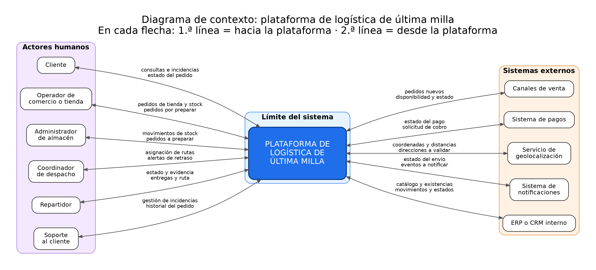

# Plataforma de gestión logística de última milla

**Actividad 1: Diagnóstico y contexto arquitectónico**

Diagnóstico inicial de una plataforma de logística de última milla para una empresa de retail digital. El trabajo se centra en **comprender y delimitar el problema** antes de proponer una arquitectura: no se eligen tecnologías ni se diseña la solución final.

- **Autor:** [Daniel Henao Carvajal]
- **Curso / institución:** [Institución Universitaria ITM]
- **Video de sustentación:** [Pega aquí el enlace al video]

---

## Resumen ejecutivo

### Producto

**Milla de Oro**: un sistema centralizado que coordina, rastrea y da trazabilidad a los pedidos desde que están confirmados hasta que llegan al cliente.

### Problema principal

La empresa no puede conocer el estado real de cada pedido porque la información está dispersa entre los canales de venta, los inventarios distribuidos, las rutas de entrega y el área de soporte. Esto genera pedidos duplicados, inventario inconsistente, entregas retrasadas o fallidas y pérdida de trazabilidad, y limita la capacidad de la empresa para crecer con control.

### Usuarios y actores

| Tipo | Quiénes |
|------|---------|
| **Personas** | Cliente, operador de comercio o tienda, administrador de almacén, repartidor, soporte al cliente, coordinador de despacho |
| **Sistemas externos** | Sistema de pagos, servicio de geolocalización, sistema de notificaciones, ERP o CRM interno, canales de venta |

El detalle de los 18 actores identificados, con lo que necesita y aporta cada uno, está en [Actores y necesidades](docs/actividad-1/02-actores-y-necesidades.md).

### Objetivos

1. Dar una **vista única y confiable** del estado de cada pedido.
2. Evitar la **duplicación** de pedidos y las **inconsistencias de inventario**.
3. Reducir las **entregas fallidas o retrasadas** mediante una mejor coordinación entre almacén, rutas y soporte.
4. Garantizar la **trazabilidad** de cada pedido.
5. Permitir que la operación **crezca sin perder el control**.

### Alcance

**Dentro del alcance:** consolidar pedidos de todos los canales, validar y reservar inventario, mantener un estado común del pedido, asignar entregas, rastrear envíos, gestionar incidencias, solicitar notificaciones, registrar el historial de eventos y ofrecer indicadores básicos.

**Fuera del alcance:** cobrar pagos, administrar el catálogo y los precios, vender en los canales, operar la bodega, calcular mapas, enviar mensajes físicamente, emitir facturas y gestionar la logística inversa completa.

Ver [Alcance](docs/actividad-1/03-alcance.md).

---

## Diagrama de contexto

La plataforma se muestra como una sola caja, rodeada de sus actores y de los sistemas externos con los que intercambia información. Ver [Diagrama de contexto](docs/actividad-1/04-diagrama-de-contexto.md).

---

## Riesgos principales

De los 15 riesgos identificados, tres son críticos y deben guiar el diseño posterior:

| Riesgo | Por qué importa |
|--------|-----------------|
| **Inconsistencias de inventario** | Se vende lo que no se tiene; es la causa raíz del síntoma más visible |
| **Entregas fallidas o retrasadas** | Es lo que el cliente percibe y lo que más cuesta |
| **Fuente de la verdad ambigua entre el ERP/CRM y la plataforma** | Es una indefinición de arquitectura que afecta al inventario y a la trazabilidad |

Ver el registro completo en [Riesgos](docs/actividad-1/05-riesgos.md).

---

## Decisiones iniciales

- Proponer **una plataforma centralizada** como respuesta a la falta de una vista única.
- Limitar el alcance a la **última milla**.
- Que la plataforma **coordine y rastree**, sin asumir pagos, catálogo ni ventas.
- **Convivir con el ERP/CRM** existente en lugar de reemplazarlo.
- **No elegir tecnologías** en esta etapa.
- **Aplazar** la decisión sobre quién es la fuente de la verdad del inventario hasta tener información del negocio.

Ver [Supuestos y decisiones](docs/actividad-1/06-supuestos-y-decisiones.md).

---

## Documentación

| # | Documento | Qué responde |
|---|-----------|--------------|
| 1 | [Análisis del problema](docs/actividad-1/01-analisis-del-problema.md) | ¿Qué pasa hoy, por qué importa y qué consecuencias tiene? |
| 2 | [Actores y necesidades](docs/actividad-1/02-actores-y-necesidades.md) | ¿Quién interactúa con el sistema y qué necesita? |
| 3 | [Alcance](docs/actividad-1/03-alcance.md) | ¿Qué hace el sistema y qué queda fuera? |
| 4 | [Diagrama de contexto](docs/actividad-1/04-diagrama-de-contexto.md) | ¿Cómo se relaciona el sistema con su entorno? |
| 5 | [Riesgos](docs/actividad-1/05-riesgos.md) | ¿Dónde puede fallar o generar pérdidas? |
| 6 | [Supuestos y decisiones](docs/actividad-1/06-supuestos-y-decisiones.md) | ¿Qué se asume, qué se decide y qué falta confirmar? |

