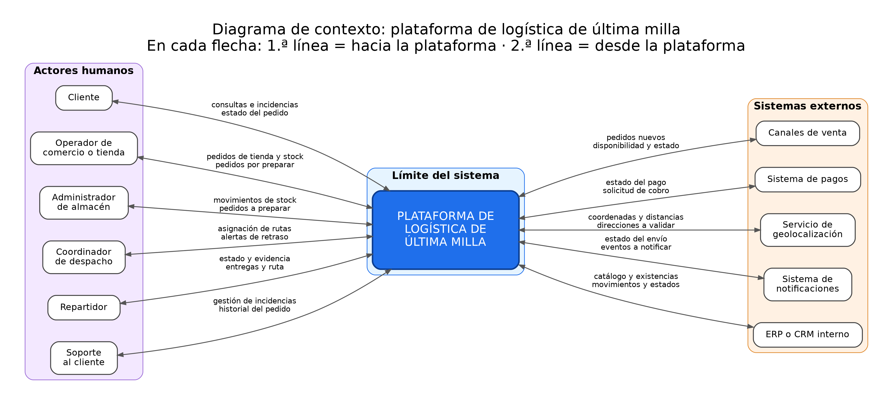
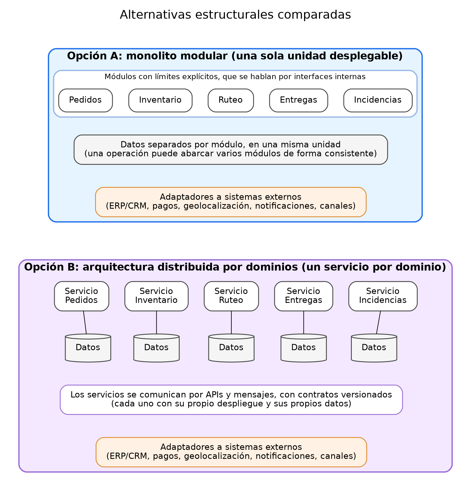
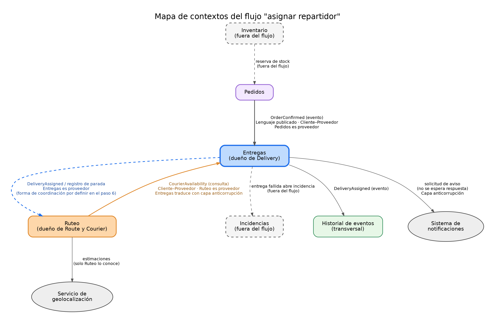
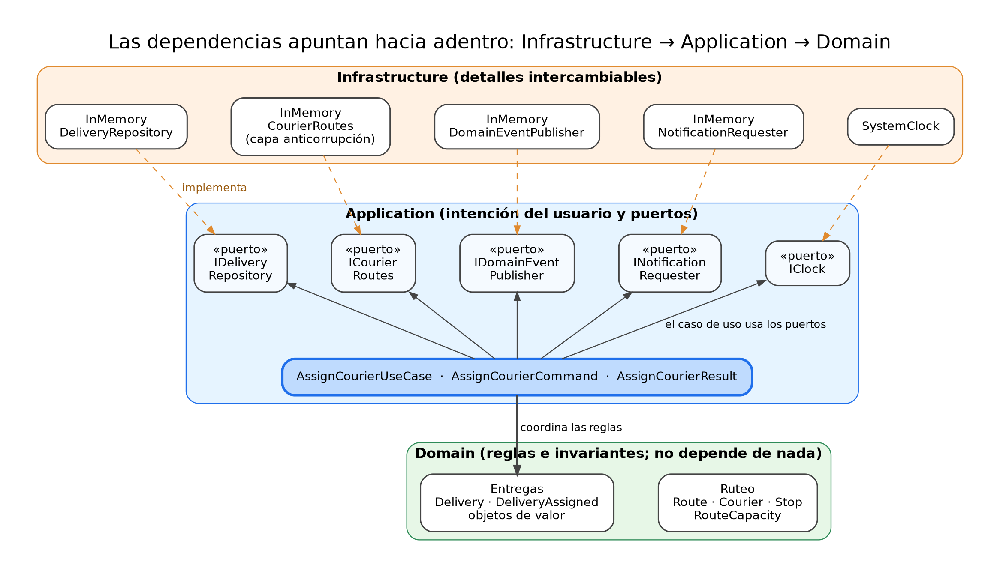
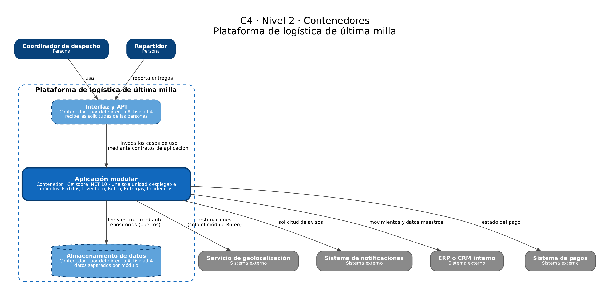
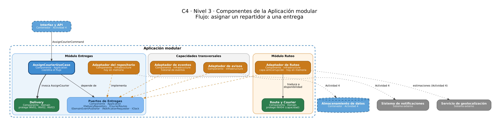
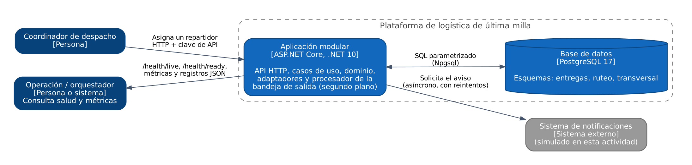
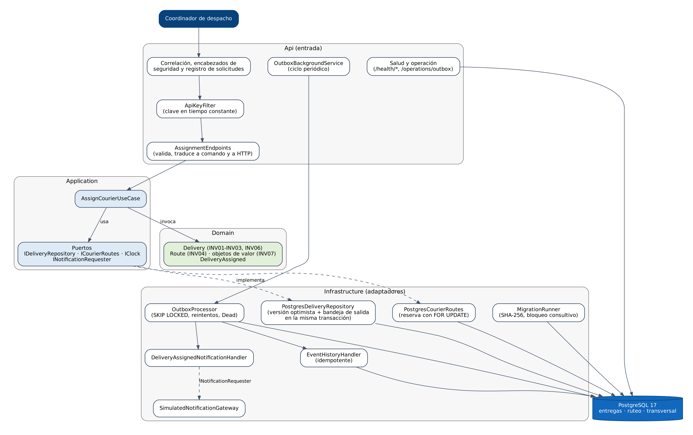

# Plataforma de gestión logística de última milla

Proyecto de arquitectura de software sobre una plataforma de logística de última milla para una empresa de retail digital. El trabajo avanza por actividades: primero se **comprende el problema**, luego se **decide la estructura** de la solución, se **diseña su dominio** y, por último, se **construye y valida** un flujo completo de punta a punta.


- **Autor:** [Daniel Henao Carvajal]
- **Curso / institución:** [ITM]
- **Arquitectura completa:** [`Architecture.md`](Architecture.md)

| Actividad | Qué resuelve | Documentos | Video |
|-----------|--------------|------------|-------|
| **1. Diagnóstico y contexto arquitectónico** | Entender el problema, los actores, el alcance y los riesgos | [`docs/actividad-1`](docs/actividad-1) | [Pendiente de publicar] |
| **2. Requisitos y decisión estructural** | Traducir el diagnóstico en requisitos y decidir cómo se organiza la plataforma | [`docs/actividad-2`](docs/actividad-2) | [Pendiente de publicar] |
| **3. Dominio y diseño** | Diseñar el modelo de dominio, sus reglas, sus límites y la separación entre negocio e infraestructura | [`docs/actividad-3`](docs/actividad-3), [`src`](src) y [`tests`](tests) | [Pendiente de publicar] |
| **4. Construcción, validación y defensa final** | Implementar el flujo de asignación de punta a punta, probarlo, hacerlo observable y evaluar sus riesgos | [`docs/actividad-4`](docs/actividad-4), [`src`](src) y [`tests`](tests) | [Pendiente de publicar] |

> Hasta la Actividad 2 no se elige ninguna tecnología. En la Actividad 3 se elige **únicamente** el lenguaje y la plataforma del esqueleto de diseño (C# sobre .NET 10, ver [ADR-002](docs/actividad-3/adr/ADR-002-lenguaje-y-plataforma-del-esqueleto.md)). En la Actividad 4 se deciden la base de datos, el framework de la entrada y el resto de la implementación (ADR-006 a ADR-010).

---

## Resumen del problema

La empresa recibe pedidos por varios canales, maneja inventarios distribuidos y coordina entregas con distintas rutas y repartidores, pero **no tiene una vista única del estado real de cada pedido**. La información está dispersa entre los canales de venta, los inventarios, las rutas y el área de soporte.

Esto genera pedidos duplicados, inventario inconsistente, entregas retrasadas o fallidas y pérdida de trazabilidad, y limita la capacidad de la empresa para crecer con control.

---

## Actividad 1: Diagnóstico y contexto arquitectónico

### Objetivos

1. Dar una **vista única y confiable** del estado de cada pedido.
2. Evitar la **duplicación** de pedidos y las **inconsistencias de inventario**.
3. Reducir las **entregas fallidas o retrasadas**.
4. Garantizar la **trazabilidad** de cada pedido.
5. Permitir que la operación **crezca sin perder el control**.

### Actores

| Tipo | Quiénes |
|------|---------|
| **Personas** | Cliente, operador de comercio o tienda, administrador de almacén, repartidor, soporte al cliente, coordinador de despacho |
| **Sistemas externos** | Sistema de pagos, servicio de geolocalización, sistema de notificaciones, ERP o CRM interno, canales de venta |

Se identificaron 18 actores en total; el detalle está en [Actores y necesidades](docs/actividad-1/02-actores-y-necesidades.md).

### Alcance

**Dentro:** consolidar pedidos de todos los canales, validar y reservar inventario, mantener un estado común del pedido, asignar entregas, rastrear envíos, gestionar incidencias, solicitar notificaciones, registrar el historial de eventos y ofrecer indicadores básicos.

**Fuera:** cobrar pagos, administrar catálogo y precios, vender en los canales, operar la bodega, calcular mapas, enviar mensajes, emitir facturas y gestionar la logística inversa completa.

### Diagrama de contexto



### Riesgos críticos

| Riesgo | Por qué importa |
|--------|-----------------|
| **Inconsistencias de inventario** | Se vende lo que no se tiene |
| **Entregas fallidas o retrasadas** | Es lo que el cliente percibe y lo que más cuesta |
| **Fuente de la verdad ambigua entre el ERP/CRM y la plataforma** | Es una indefinición que afecta al inventario y a la trazabilidad |

Se registraron 15 riesgos en total. Ver [Riesgos](docs/actividad-1/05-riesgos.md).

---

## Actividad 2: Requisitos y decisión estructural

### Requisitos prioritarios

Se definieron **20 requisitos funcionales**, **13 atributos de calidad** y **7 restricciones**, y se priorizaron según su impacto en el negocio y en la arquitectura. De los 33 requisitos, 21 son *Must*.

Los cinco que mejor resumen lo que el negocio necesita:

| # | Requisito prioritario | Por qué |
|---|-----------------------|---------|
| 1 | **Estado común del pedido** con historial de eventos | Es la respuesta directa a la falta de una vista única |
| 2 | **Inventario consistente** con reserva al confirmar el pedido | Evita vender lo que no existe |
| 3 | **Asignación de entregas** a rutas y repartidores | Es el núcleo de la coordinación y el dominio con más carga |
| 4 | **Integración con el ERP/CRM** con contratos estables | Es la integración más delicada del sistema |
| 5 | **Seguridad por rol** de los datos personales | Hay información sensible y roles diferenciados |

Los atributos de calidad que más condicionan la estructura son la **consistencia de datos**, la **disponibilidad**, la **trazabilidad**, la **evolución**, la **interoperabilidad**, la **tolerancia a mala conectividad** y la **operabilidad con un equipo pequeño**.

### Escenarios de calidad destacados

Se redactaron 15 escenarios con medidas concretas. Las cifras son supuestos de trabajo, a validar con el negocio.

| Escenario | Condición | Medida |
|-----------|-----------|--------|
| **QS01** Reserva concurrente | Dos pedidos piden a la vez la última unidad de un producto | 0 sobreventas |
| **QS07** Asignación de rutas | Asignar 200 entregas pendientes | Propuesta en 30 segundos o menos, sin afectar al resto |
| **QS10** Conectividad | Un repartidor pierde señal durante 20 minutos | Sincronización en 2 minutos, 0 reportes perdidos |
| **QS14** Operación | Un equipo de 2 o 3 personas publica una versión | Despliegue en 30 minutos o menos, reversión en 15 |

### Alternativas comparadas



| Alternativa | Puntaje ponderado | Lo mejor | Lo peor |
|-------------|-------------------|----------|---------|
| **A. Monolito modular con límites claros** | **3,75** | Consistencia, costo y rapidez | Escala como una sola unidad |
| B. Arquitectura distribuida por dominios | 2,90 | Autonomía y aislamiento de fallas | Complejidad y costo operativo |

Si el negocio creciera con rapidez y con varios equipos, ambas empatan en 3,45. La decisión depende de los supuestos de equipo pequeño y volumen moderado.

### Decisión arquitectónica

Se adopta un **monolito modular con límites de dominio explícitos**: una sola unidad desplegable, organizada en módulos por dominio (**Pedidos, Inventario, Ruteo, Entregas e Incidencias**), que se comunican por interfaces y se conectan a los sistemas externos mediante adaptadores con contratos versionados.

**Por qué:**

- Protege lo más sensible del caso: una reserva de inventario y el cambio de estado se hacen en una sola operación.
- Facilita la trazabilidad y la seguridad, porque el historial y los permisos viven en un solo lugar.
- Cumple 12 de los 15 escenarios de calidad, frente a 9 de la alternativa B.
- Un equipo pequeño puede operarla, y llega antes a resolver el problema.

**Qué se cede:** independencia de despliegue, escalado separado por dominio y aislamiento fuerte de fallas.

**Camino de evolución:** si la carga, la latencia, la autonomía o el costo operativo lo justifican, **Ruteo** puede extraerse como servicio independiente sin rehacer el resto. Las condiciones están definidas en el ADR.

Ver [ADR-001](docs/actividad-2/adr/ADR-001-estructura-de-la-plataforma.md). La fuente de la verdad del inventario sigue abierta y se tratará en un ADR posterior.

### Criterios verificables

Cuatro bloques de comprobación: **estructura** (siete reglas de la decisión), **calidad** (los 15 escenarios), **negocio** (seis indicadores sobre el problema original) y **revisión** (cinco condiciones que reabren la decisión). Ver [Criterios verificables](docs/actividad-2/05-criterios-verificables.md).

---

## Actividad 3: Dominio y diseño

### Flujo diseñado

Se diseña el flujo **asignar un repartidor a una entrega**: el coordinador de despacho elige una entrega pendiente y un repartidor, y la plataforma verifica las reglas, registra la asignación y avisa al repartidor. Es el núcleo de la coordinación (RF09) y cruza dos contextos, Entregas y Ruteo, lo que permite practicar límites y contratos. Ver [Flujo de negocio](docs/actividad-3/01-flujo-de-negocio.md).

### Modelo de dominio

| Concepto | Tipo | Contexto |
|----------|------|----------|
| `Delivery` | Entidad, raíz de agregado | Entregas |
| `Route` | Entidad, raíz de agregado | Ruteo |
| `Courier` | Entidad | Ruteo |
| `DeliveryAddress`, `DeliveryWindow`, `DeliveryPriority`, `DeliveryStatus` | Objetos de valor | Entregas |
| `RouteCapacity`, `Stop` | Objetos de valor | Ruteo |
| `DeliveryAssigned` | Evento de dominio | Entregas |

El glosario con los términos del negocio y sus nombres en código está en [Lenguaje ubicuo](docs/actividad-3/02-lenguaje-ubicuo.md), y el modelo con sus estados y transiciones en [Modelo de dominio](docs/actividad-3/03-modelo-de-dominio.md).

### Invariantes y escenarios de aceptación

Las reglas que siempre deben cumplirse están protegidas dentro del dominio:

| Regla | La protege |
|-------|------------|
| Una entrega no puede tener más de un repartidor activo | `Delivery` |
| Solo se asigna una entrega pendiente de asignación | `Delivery` |
| El estado de la entrega y su repartidor son coherentes | `Delivery` |
| Una ruta no puede superar su capacidad | `Route` |
| Los objetos de valor no pueden existir en un estado inválido | Cada objeto de valor |

Se redactaron **15 escenarios de aceptación** en formato Dado-Cuando-Entonces, uno de los cuales es:

```gherkin
Escenario: Asignar un repartidor disponible a una entrega pendiente
  Dado una entrega "E-100" en estado "Pendiente de asignación"
  Y un repartidor activo "Carlos" con una ruta de capacidad 8 y 5 paradas
  Cuando el coordinador asigna a "Carlos" la entrega "E-100"
  Entonces la entrega "E-100" queda "Asignada" a "Carlos"
  Y se registra el evento "Entrega asignada" con la entrega, el repartidor, el coordinador y la hora
  Y se solicita un aviso para "Carlos"
```

Ver [Invariantes y escenarios](docs/actividad-3/04-invariantes-y-escenarios.md).

### Contextos y contratos



Cada contexto tiene su propio modelo y su propio lenguaje, y se comunican mediante contratos versionados:

| Contrato | De → A | Qué comunica |
|----------|--------|--------------|
| **C1** `OrderConfirmed` | Pedidos → Entregas | Un pedido quedó confirmado |
| **C2** `CourierAvailability` | Entregas → Ruteo | ¿Puede este repartidor recibir otra entrega? |
| **C3** Reserva de parada | Entregas → Ruteo | Reservar o liberar un cupo en la ruta |
| **C4** `DeliveryAssigned` | Entregas → Historial | A una entrega se le asignó un repartidor |
| **C5** Solicitud de aviso | Entregas → Notificaciones | Avisar al repartidor |

Ver [Contextos y contratos](docs/actividad-3/05-contextos-y-contratos.md).

### Capas, puertos y adaptadores



El código se organiza en tres capas con las **dependencias dirigidas hacia adentro**: la aplicación define los puertos y la infraestructura los implementa.

| Puerto | Necesidad que expresa | Adaptador actual |
|--------|----------------------|------------------|
| `IDeliveryRepository` | Obtener y guardar entregas | En memoria |
| `ICourierRoutes` | Consultar disponibilidad y reservar un cupo en la ruta | En memoria |
| `IDomainEventPublisher` | Registrar los hechos ocurridos | En memoria |
| `INotificationRequester` | Solicitar un aviso al repartidor | En memoria |
| `IClock` | Obtener la hora actual | Reloj del sistema |

El caso de uso `AssignCourierUseCase` coordina el flujo, y las reglas del negocio viven en el dominio. Ver [Casos de uso, puertos y adaptadores](docs/actividad-3/06-casos-de-uso-puertos-adaptadores.md).

### Diagrama C4





El nivel 1 (contexto) está en [`c4-1-contexto.png`](docs/actividad-3/diagramas/c4-1-contexto.png). La interfaz y el almacenamiento aparecen con línea punteada porque se construyen en la Actividad 4. La descripción completa de la arquitectura está en [`Architecture.md`](Architecture.md).

### Decisiones de diseño

| ADR | Decisión |
|-----|----------|
| [ADR-002](docs/actividad-3/adr/ADR-002-lenguaje-y-plataforma-del-esqueleto.md) | C# sobre .NET 10 para el esqueleto de diseño; no incluye base de datos, frameworks ni proveedores |
| [ADR-003](docs/actividad-3/adr/ADR-003-capas-y-dependencias.md) | Tres capas con inversión de dependencias, puertos y adaptadores |
| [ADR-004](docs/actividad-3/adr/ADR-004-coordinacion-entre-entregas-y-ruteo.md) | Reserva previa del cupo con liberación compensatoria entre Entregas y Ruteo |
| [ADR-005](docs/actividad-3/adr/ADR-005-rechazos-eventos-y-avisos.md) | Rechazos como resultados con códigos estables, evento registrado tras guardar y aviso que no revierte la asignación |

### Cómo construir y probar

Requisito: SDK de .NET 10. Desde la raíz del repositorio:

```bash
dotnet build
dotnet test
```

Las pruebas del dominio y de la aplicación no usan base de datos ni servicios externos. Las de integración usan adaptadores en memoria y comprueban la concurrencia. En total son 38 pruebas: 22 del dominio, 13 de la aplicación y 3 de integración.

### Qué quedaba para la Actividad 4

Persistencia real, interfaz o API, integraciones con los sistemas externos y la garantía de que el evento no se pierda si falla su registro. Todo esto se resolvió en la Actividad 4, salvo la integración real con el sistema de notificaciones, que se simula. La decisión sobre la fuente de la verdad del inventario sigue abierta.

---

## Actividad 4: Construcción, validación y defensa final

### Qué se construyó

El flujo **asignar un repartidor a una entrega** funciona de punta a punta como un *vertical slice* ejecutable: API HTTP, caso de uso, dominio, PostgreSQL y bandeja de salida con procesamiento asíncrono.





| Pieza | Qué hace |
|-------|----------|
| **Entrada HTTP** | `POST /api/v1/deliveries/{deliveryId}/assignment`, con clave de API y códigos de respuesta estables |
| **Persistencia** | PostgreSQL 17, esquemas separados por módulo, SQL parametrizado y migraciones versionadas con suma de verificación |
| **Concurrencia** | Versión optimista en la entrega y bloqueo de fila al reservar el cupo de la ruta |
| **Bandeja de salida** | El evento se guarda con la entrega; un procesador lo entrega con reintentos de espera creciente y estado `Dead` si se agotan |
| **Observabilidad** | Registros JSON con identificador de correlación, métricas, `/health/live` y `/health/ready`, sin datos sensibles |
| **Verificaciones automáticas** | 18 pruebas de arquitectura y seguridad, e integración continua con auditoría de dependencias |

El dominio **no cambió** para conectar la persistencia: esa es la prueba de que la separación de capas del diseño era correcta.

### Ajustes al diseño de la Actividad 3

| Ajuste | Qué cambió | Por qué |
|--------|-----------|---------|
| AJ-01 a AJ-03 | El evento se guarda en la **bandeja de salida**, en la misma transacción que la entrega; el caso de uso ya no publica ni avisa directamente | Elimina el evento perdido que el ADR-005 dejó abierto |
| AJ-04 | Ruteo vive en la misma base, en un esquema propio | Respeta la separación de datos por módulo sin multiplicar almacenes |
| AJ-05 | Datos de demostración en desarrollo | La creación de entregas desde pedidos queda fuera del slice |
| AJ-06 | Reservas con vencimiento: **aplazado** | Queda como riesgo residual (RI08) |

### Demostración rápida

Con Docker y .NET 10 instalados, desde la raíz del repositorio:

```bash
docker compose up -d
dotnet run --project src/Api
```

En otra terminal (Windows, con `curl.exe`), asignar a Luisa la primera entrega de demostración:

```bash
curl.exe -i -X POST "http://localhost:5080/api/v1/deliveries/d0000000-0000-0000-0000-000000000001/assignment" -H "X-Api-Key: clave-de-desarrollo" -H "X-Requested-By: sandra" -H "Content-Type: application/json" -d "{\"courierId\":\"a0000000-0000-0000-0000-000000000002\"}"
```

| Escenario | Entrega → repartidor | Resultado |
|-----------|----------------------|-----------|
| Asignación válida | `…0001` → Luisa (`a…0002`) | 200 |
| Repetir la misma entrega | `…0001` → Luisa | 409 `DELIVERY_ALREADY_ASSIGNED` |
| Ruta saturada | `…0002` → Camilo (`a…0004`) | 409 `ROUTE_SATURATED` |
| Repartidor inactivo | `…0003` → Paola (`a…0003`) | 422 `COURIER_NOT_ACTIVE` |
| Sin clave de API | cualquiera | 401 |

La clave de desarrollo es solo para uso local. Para ver el estado de la bandeja de salida y la salud: `http://localhost:5080/health/ready` y, con la clave, `/api/v1/operations/outbox`.

### Resultados

**122 pruebas correctas** (ejecución local del 24 de noviembre de 2026): unitarias de las invariantes, de integración contra PostgreSQL real (concurrencia, ruta saturada, base caída, aviso que siempre falla), de observabilidad y de arquitectura. La integración continua repite todo en cada cambio.

No se midió cobertura, rendimiento ni capacidad, y no se ejecutó análisis estático (SAST), dinámico (DAST) ni pruebas de penetración.

### Decisiones de implementación

| ADR | Decisión |
|-----|----------|
| [ADR-006](docs/actividad-4/adr/ADR-006-persistencia-postgresql-y-migraciones.md) | PostgreSQL, SQL parametrizado sin ORM y migraciones versionadas |
| [ADR-007](docs/actividad-4/adr/ADR-007-bandeja-de-salida-reintentos-y-mensajes-muertos.md) | Bandeja de salida transaccional con reintentos y mensajes muertos (ajusta el ADR-005) |
| [ADR-008](docs/actividad-4/adr/ADR-008-entrada-http-y-clave-de-api.md) | Entrada HTTP con clave de API y traducción de rechazos |
| [ADR-009](docs/actividad-4/adr/ADR-009-observabilidad-sin-datos-sensibles.md) | Registros, métricas y salud sin datos sensibles |
| [ADR-010](docs/actividad-4/adr/ADR-010-verificaciones-automaticas.md) | Pruebas de arquitectura e integración continua |

### Riesgos residuales principales

- **Cupo huérfano:** si el proceso muere entre reservar y guardar, el cupo queda ocupado (caducidad de reservas sin implementar).
- **Mensajes `Dead`:** se detectan por la salud degradada, pero no se reprocesan ni generan alertas.
- **Identidad débil:** la clave de API es un secreto compartido; no identifica a cada persona.
- **Sin límite de solicitudes, copias de seguridad ni alta disponibilidad.**
- **El sistema de notificaciones es simulado** y la fuente de la verdad del inventario sigue sin decidirse.

El registro completo, con la mitigación y la evidencia de cada riesgo, está en [Riesgos, resultados y próximos pasos](docs/actividad-4/05-riesgos-resultados-y-proximos-pasos.md).

### Cómo construir y probar

Requisitos: SDK de .NET 10 y Docker.

```bash
docker compose up -d
dotnet build
dotnet test
```

Defina la variable de entorno `LOGISTICA_TEST_POSTGRES` con la cadena de conexión a su servidor PostgreSQL para que se ejecuten las pruebas de integración con base de datos; sin ella se omiten con un aviso. Ejemplo en Windows (cmd):

```bash
set LOGISTICA_TEST_POSTGRES=Host=localhost;Port=5432;Username=postgres;Password=postgres;Database=postgres
```

---

## Documentación

### Actividad 1

| # | Documento | Qué responde |
|---|-----------|--------------|
| 1 | [Análisis del problema](docs/actividad-1/01-analisis-del-problema.md) | ¿Qué pasa hoy, por qué importa y qué consecuencias tiene? |
| 2 | [Actores y necesidades](docs/actividad-1/02-actores-y-necesidades.md) | ¿Quién interactúa con el sistema y qué necesita? |
| 3 | [Alcance](docs/actividad-1/03-alcance.md) | ¿Qué hace el sistema y qué queda fuera? |
| 4 | [Diagrama de contexto](docs/actividad-1/04-diagrama-de-contexto.md) | ¿Cómo se relaciona con su entorno? |
| 5 | [Riesgos](docs/actividad-1/05-riesgos.md) | ¿Dónde puede fallar o generar pérdidas? |
| 6 | [Supuestos y decisiones](docs/actividad-1/06-supuestos-y-decisiones.md) | ¿Qué se asume, qué se decide y qué falta confirmar? |

### Actividad 2

| # | Documento | Qué responde |
|---|-----------|--------------|
| 1 | [Catálogo de requisitos](docs/actividad-2/01-catalogo-de-requisitos.md) | ¿Qué debe hacer el sistema y con qué cualidades? |
| 2 | [Matriz de priorización](docs/actividad-2/02-matriz-de-priorizacion.md) | ¿Qué importa más y por qué? |
| 3 | [Escenarios de calidad](docs/actividad-2/03-escenarios-de-calidad.md) | ¿Cómo se comprueba cada cualidad? |
| 4 | [Comparación de alternativas](docs/actividad-2/04-comparacion-de-alternativas.md) | ¿Qué estructuras son posibles y cuál conviene? |
| 5 | [Criterios verificables](docs/actividad-2/05-criterios-verificables.md) | ¿Cómo se sabe si la decisión funciona? |
| ADR | [ADR-001](docs/actividad-2/adr/ADR-001-estructura-de-la-plataforma.md) | ¿Qué se decidió, por qué y a qué costo? |

---

### Actividad 3

| # | Documento | Qué responde |
|---|-----------|--------------|
| 1 | [Flujo de negocio](docs/actividad-3/01-flujo-de-negocio.md) | ¿Qué flujo se diseña y para qué? |
| 2 | [Lenguaje ubicuo](docs/actividad-3/02-lenguaje-ubicuo.md) | ¿Qué significa cada término en cada contexto? |
| 3 | [Modelo de dominio](docs/actividad-3/03-modelo-de-dominio.md) | ¿Qué entidades y objetos de valor hay, con qué estados? |
| 4 | [Invariantes y escenarios](docs/actividad-3/04-invariantes-y-escenarios.md) | ¿Qué reglas nunca se rompen y cómo se comprueban? |
| 5 | [Contextos y contratos](docs/actividad-3/05-contextos-y-contratos.md) | ¿Qué contextos participan y qué intercambian? |
| 6 | [Casos de uso, puertos y adaptadores](docs/actividad-3/06-casos-de-uso-puertos-adaptadores.md) | ¿Cómo se organiza el caso de uso y hacia dónde apuntan las dependencias? |
| ADR | [ADR-002 a ADR-005](docs/actividad-3/adr) | ¿Qué decisiones de diseño se tomaron y qué se descartó? |
| Arq. | [Architecture.md](Architecture.md) | ¿Cómo se ve la arquitectura completa? |

---

### Actividad 4

| # | Documento | Qué responde |
|---|-----------|--------------|
| 1 | [Plan de implementación](docs/actividad-4/01-plan-de-implementacion.md) | ¿Qué se construye, con qué decisiones y cómo se traza con el diseño? |
| 2 | [Bandeja de salida y reintentos](docs/actividad-4/02-bandeja-de-salida-y-reintentos.md) | ¿Cómo llegan los eventos sin perderse y qué pasa si algo falla? |
| 3 | [Observabilidad y seguridad](docs/actividad-4/03-observabilidad-y-seguridad.md) | ¿Cómo se diagnostica el flujo sin exponer datos sensibles? |
| 4 | [Verificaciones automáticas](docs/actividad-4/04-verificaciones-automaticas.md) | ¿Qué reglas se comprueban solas en cada cambio? |
| 5 | [Riesgos, resultados y próximos pasos](docs/actividad-4/05-riesgos-resultados-y-proximos-pasos.md) | ¿Qué riesgos hay, qué evidencia los respalda y qué sigue abierto? |
| ADR | [ADR-006 a ADR-010](docs/actividad-4/adr) | ¿Qué decisiones de implementación se tomaron y qué se descartó? |

---

## Estructura del repositorio

```
logistica-ultima-milla/
├── README.md
├── Architecture.md
├── Directory.Build.props
├── docker-compose.yml
├── .github/
│   ├── workflows/ci.yml
│   └── dependabot.yml
├── docs/
│   ├── actividad-1/   (6 documentos y diagramas)
│   ├── actividad-2/   (5 documentos, ADR-001 y diagramas)
│   ├── actividad-3/   (6 documentos, ADR-002 a ADR-005 y diagramas)
│   └── actividad-4/   (5 documentos, ADR-006 a ADR-010 y diagramas)
├── src/
│   ├── Domain/
│   ├── Application/
│   ├── Infrastructure/
│   └── Api/
└── tests/
    ├── Domain.Tests/
    ├── Application.Tests/
    └── Integration.Tests/   (incluye Architecture/)
```

---

## Estado

### Actividad 1
- [x] Problema definido con claridad
- [x] Usuarios y actores identificados
- [x] Alcance delimitado
- [x] Diagrama de contexto
- [x] Riesgos principales listados
- [x] Supuestos explícitos
- [x] Decisiones iniciales justificadas
- [ ] Video de sustentación entregado

### Actividad 2
- [x] Requisitos funcionales claros
- [x] Requisitos no funcionales definidos
- [x] Escenarios de calidad con métricas
- [x] Al menos dos alternativas comparadas
- [x] Decisión argumentada con trade-offs
- [x] Registro de decisión arquitectónica (ADR)
- [x] Criterios verificables
- [ ] Video de sustentación entregado

### Actividad 3
- [x] Modelo de dominio definido
- [x] Entidades y objetos de valor diferenciados
- [x] Invariantes listados
- [x] Lenguaje ubicuo y límites de contexto documentados
- [x] Escenarios de aceptación escritos en Dado-Cuando-Entonces
- [x] Casos de uso principales descritos
- [x] Contratos de aplicación definidos
- [x] Puertos y adaptadores propuestos con dependencias dirigidas correctamente
- [x] Diagrama C4 actualizado
- [x] Architecture.md y ADR actualizados
- [x] README actualizado con la propuesta y los diagramas
- [ ] Video de sustentación entregado

### Actividad 4
- [x] Flujo implementado como vertical slice ejecutable
- [x] Entrada conectada con el caso de uso, el dominio y la persistencia mediante los contratos
- [x] Adaptador asíncrono con reintentos y mensajes fallidos
- [x] Migraciones reproducibles
- [x] Historial de cambios y decisiones de implementación documentadas (ADR-006 a ADR-010)
- [x] Pruebas unitarias de las invariantes y de integración, con escenarios de error y de límite
- [x] Riesgos con mitigación y evidencia
- [x] Señales de observabilidad sin datos sensibles
- [x] Comprobación automatizada de arquitectura y calidad, con resultados y riesgos residuales
- [ ] Video de demostración y sustentación entregado
