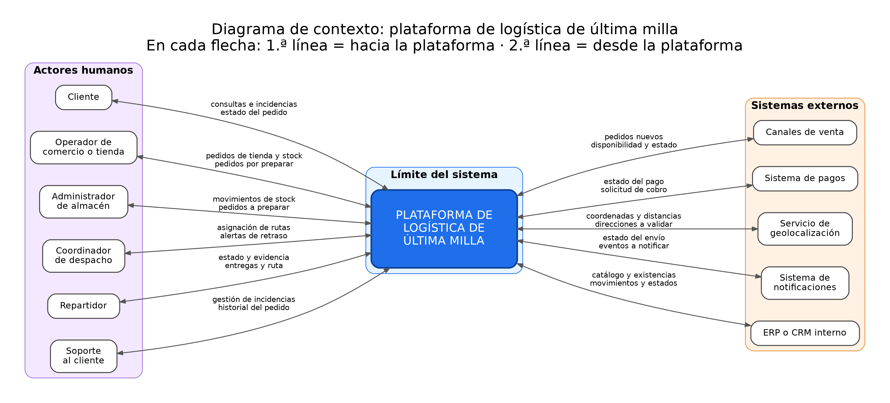

# Diagrama de contexto

## 1. Propósito

El diagrama de contexto muestra la plataforma como **una sola caja negra** y la relaciona con las personas y los sistemas que la rodean. Responde cuatro preguntas:

1. ¿Quién usa el sistema?
2. ¿Con qué sistemas externos se conecta?
3. ¿Qué información viaja en cada dirección?
4. ¿Dónde termina el sistema y dónde empieza el entorno?

No muestra componentes internos, bases de datos ni tecnologías. Eso corresponde a actividades posteriores.

## 2. Diagrama

## 3. Cómo leer el diagrama

- **Izquierda:** las personas que operan o consumen la plataforma.
- **Centro:** el sistema, dentro de su límite. Es una caja única.
- **Derecha:** los sistemas con los que intercambia información.
- **Flechas:** cada interlocutor tiene una sola flecha con doble punta. En la etiqueta, la **primera línea** es lo que entra a la plataforma y la **segunda línea** es lo que sale de ella.

## 4. Flujos representados

| Interlocutor | Hacia la plataforma | Desde la plataforma |
|--------------|---------------------|---------------------|
| Cliente | Consultas de estado, incidencias | Estado del pedido |
| Operador de comercio o tienda | Pedidos de tienda, stock del punto | Pedidos por preparar |
| Administrador de almacén | Movimientos de stock, pedido preparado | Pedidos a preparar, alertas de faltantes |
| Coordinador de despacho | Asignación y reasignación de rutas | Pedidos listos, alertas de retraso |
| Repartidor | Estado, ubicación, evidencia de entrega | Entregas asignadas y ruta |
| Soporte al cliente | Gestión de incidencias | Historial completo del pedido |
| Canales de venta | Pedidos nuevos, cancelaciones | Disponibilidad y estado del pedido |
| Sistema de pagos | Estado del pago | Solicitud de cobro o reembolso |
| Servicio de geolocalización | Coordenadas, distancias, ubicación en tiempo real | Direcciones a validar |
| Sistema de notificaciones | Estado del envío | Eventos a notificar |
| ERP o CRM interno | Catálogo, clientes, existencias | Movimientos y estados de entrega |

Estos flujos corresponden a los definidos en `02-actores-y-necesidades.md` (F1 a F10).

## 5. Límite del sistema

**Dentro del límite:** registro y consolidación de pedidos, validación de inventario, estado común del pedido, asignación de entregas, rastreo, incidencias, historial de eventos e indicadores (ver `03-alcance.md`).

**Fuera del límite:** cobro de pagos, catálogo y precios, venta en los canales, cálculo de mapas, envío físico de mensajes, operación interna de la bodega.

## 6. Decisiones de modelado

1. **Actores omitidos del dibujo.** Para mantener el diagrama legible no se dibujan los actores de menor interacción directa. Están descritos en `02-actores-y-necesidades.md`:
   - Gerente de operaciones o analista (consulta indicadores).
   - Administrador de la plataforma (gestiona accesos).
   - Agente de atención telefónica (se modela dentro de los canales de venta).
   - Operador logístico tercero (se agrupa con repartidor mientras no se confirme su existencia).
   - Receptor del pedido (se agrupa con cliente).
   - Sistema de facturación electrónica y proveedores (fase posterior).
2. **Canales de venta agrupados.** Sitio web, app, marketplace y atención telefónica se muestran como un solo sistema externo para no saturar el dibujo.
3. **Una flecha por interlocutor.** Se usa una flecha bidireccional con los dos flujos en la etiqueta, para evitar un diagrama con decenas de líneas cruzadas.
4. **Notificaciones al cliente.** El aviso llega al cliente desde el sistema de notificaciones, no desde la plataforma directamente. Por eso la flecha hacia el cliente en el diagrama es solo el **estado del pedido** que él consulta.
5. **ERP o CRM.** Se dibuja como sistema externo con intercambio en ambos sentidos. Queda pendiente confirmar cuál es la **fuente de la verdad** del inventario (ver `06-supuestos-y-decisiones.md`).

## 7. Qué se evita deliberadamente

- Componentes internos, módulos o bases de datos.
- Tecnologías, marcas o protocolos.
- Flechas sin etiqueta: cada flujo dice qué información viaja.
