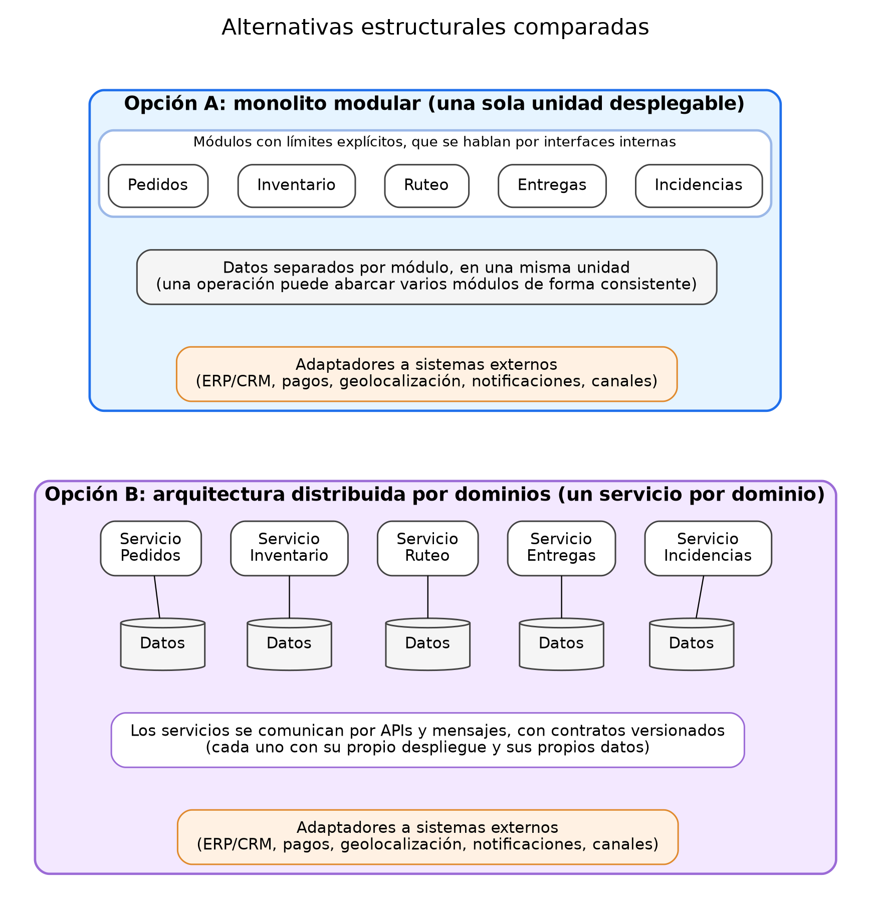

# Comparación de alternativas estructurales

## 1. Introducción

Este documento compara dos formas de organizar la plataforma de logística de última milla y evalúa cuál responde mejor a los requisitos, escenarios y riesgos definidos hasta ahora. La decisión final se documenta en el ADR; aquí se construye el análisis que la sustenta.

La pregunta no es "cuál es la mejor arquitectura", sino **cuál es la más apropiada para este caso**: un negocio de retail digital con un problema de visibilidad y trazabilidad, volumen moderado con picos, un ERP/CRM existente y, según los supuestos, un equipo pequeño.

> Se comparan **estructuras**, no tecnologías. No se elige ningún lenguaje, producto ni proveedor (decisión D11 de la Actividad 1).

## 2. Qué condiciona la decisión

### Requisitos con mayor impacto arquitectónico

Tomados de la sección 6 de `02-matriz-de-priorizacion.md`:

| Requisito | Qué exige a la estructura |
|-----------|---------------------------|
| RNF03 Consistencia + RF04 Reserva de inventario | Evitar sobreventas, incluso con operaciones simultáneas |
| RNF05 Trazabilidad + RF07 Estado común + RF16 Historial | Una fuente confiable del recorrido de cada pedido |
| RF19 Integración con ERP/CRM + RNF08 Contratos | Fronteras e interfaces estables con sistemas externos |
| RF09 Asignación de rutas | Absorber la carga del dominio más exigente |
| RNF02 Disponibilidad + RNF09 Resiliencia | Aislar fallas |
| RNF07 Evolución | Cambiar un dominio sin arrastrar a los demás |
| RNF13 Operabilidad y costo | Una complejidad que el equipo pueda sostener |

### Supuestos que pesan en la comparación

| ID | Supuesto | Fuente |
|----|----------|--------|
| A2-S01 | El equipo de desarrollo y operación es pequeño (2 a 3 personas) | `01-catalogo-de-requisitos.md` |
| A2-S02 | Volumen moderado con picos y crecimiento gradual | `01-catalogo-de-requisitos.md` |
| A2-S03 | No hay hoy capacidad de operar muchos servicios independientes | `01-catalogo-de-requisitos.md` |
| A2-S06 | Los parámetros de volumen de referencia (3.000 pedidos al día, picos de 1.000 por hora) son estimaciones | `03-escenarios-de-calidad.md` |

### Riesgos de la Actividad 1 que la estructura debe atender

Los críticos son **R02** (inconsistencias de inventario), **R03** (entregas fallidas o retrasadas) y **R07** (fuente de la verdad ambigua). También pesan **R14** (punto único de falla) y **R13** (crecimiento del alcance).

## 3. Dominios y significado por contexto

Las dos alternativas separan el sistema en los mismos dominios: **Pedidos, Inventario, Ruteo, Entregas** e **Incidencias**, más las capacidades transversales (historial, accesos, indicadores, integración). Lo que cambia entre alternativas es **cuán fuerte es la separación** y cómo se comunican.

Cada dominio tiene su propio modelo y reglas. Una misma palabra puede significar cosas distintas en cada uno, y confundirlas es una fuente de errores como la sobreventa:

| Término | Pedidos | Inventario | Ruteo | Entregas |
|---------|---------|------------|-------|----------|
| **Disponible** | El producto puede ofrecerse y el pedido puede confirmarse | Existencias físicas menos reservas y bloqueos de un punto | El repartidor está libre y con capacidad en su jornada | El cliente o receptor puede recibir en la ventana pactada |
| **Asignado** | Tiene un responsable de despacho | Las unidades están reservadas para ese pedido | El pedido está incluido en una ruta con un repartidor | El repartidor lo tiene en su lista del día |
| **Entregado** | El ciclo del pedido se cierra con éxito | Las unidades se descuentan de forma definitiva | La parada se completa y libera capacidad | Hay evidencia registrada de la recepción |
| **Cancelado** | El pedido se anula por el cliente o el sistema | La reserva se libera | La parada se retira de la ruta | La entrega se anula y la mercancía queda por devolver |

**Regla:** cada dominio conserva su propia definición, y la traducción entre contextos se hace en las fronteras, a través de interfaces explícitas. Esta regla se cumple en ambas alternativas.

## 4. Alternativas

### 4.1 Opción A: monolito modular con límites claros

Una sola unidad desplegable, organizada en módulos por dominio. Cada módulo tiene su modelo, sus reglas y sus datos, y solo se comunica con los demás mediante interfaces explícitas. Las integraciones con sistemas externos pasan por adaptadores.

| Ventajas | Desventajas |
|----------|-------------|
| Es más rápida de construir y de poner en marcha | Puede degradarse en una base de código acoplada si los límites no se hacen cumplir |
| Una operación puede abarcar varios módulos de forma consistente, por ejemplo reservar inventario y cambiar el estado del pedido | Se despliega y se escala como una sola unidad |
| Un despliegue y un monitoreo; operación sencilla para un equipo pequeño | Una falla grave puede afectar a toda la plataforma |
| El historial y los permisos viven en un solo lugar, lo que facilita la trazabilidad y la seguridad | Un dominio con mucha carga, como Ruteo, compite por recursos con el resto |
| Costo inicial y de operación bajos | Si el negocio crece mucho, puede exigir una separación posterior |

**Riesgos propios:** acoplamiento creciente entre módulos (se mitiga definiendo reglas de dependencia y verificándolas) y carga de Ruteo sobre el resto (se mitiga aislando ese módulo o ejecutándolo de forma diferida).

### 4.2 Opción B: arquitectura distribuida por dominios

Un servicio independiente por dominio, cada uno con su propio despliegue y sus propios datos. Se comunican mediante interfaces y mensajes con contratos versionados.

| Ventajas | Desventajas |
|----------|-------------|
| Separa fuertemente Inventario, Entregas, Ruteo y soporte | Aumenta la complejidad operativa: más piezas que desplegar, monitorear y recuperar |
| Cada dominio escala y se despliega por separado | La consistencia entre servicios es más difícil: reservar inventario y cambiar el estado del pedido exige coordinar dos servicios |
| Aísla las fallas de un servicio | Exige más infraestructura y más coordinación técnica |
| Permite que equipos distintos trabajen en paralelo | La trazabilidad y los permisos deben reunirse desde varios lugares |
| Facilita integrar muchos sistemas externos | Puede ser un sobrediseño si el negocio aún no lo requiere |

**Riesgos propios:** estados intermedios inconsistentes (por ejemplo, pedido confirmado sin reserva), costo operativo superior a la capacidad del equipo y dificultad para seguir un pedido a través de varios servicios.

### 4.3 Alternativas consideradas pero no comparadas a fondo

| Alternativa | Por qué no se compara como opción independiente |
|-------------|------------------------------------------------|
| Arquitectura por capas | Describe **cómo se organiza el código dentro de una unidad**, no cómo se divide el sistema en dominios. Se puede usar dentro de la Opción A |
| Cliente-servidor | Es el modelo general de interacción con los usuarios y no distingue entre las dos alternativas |
| Enfoque basado en eventos | Es una forma de comunicación que puede complementar cualquiera de las dos. Se usaría para notificar cambios, no como estructura base |
| Microservicios muy finos de entrada | Es una versión extrema de la Opción B, con costos aún mayores y sin evidencia que la justifique |

## 5. Criterios y pesos

Los criterios combinan los que pide la actividad (complejidad, costo, rapidez, evolución, riesgo operativo y alineación con el negocio) con los del video 7 (carga, latencia, autonomía y costo operativo) y la consistencia de datos, que es el requisito más sensible del caso.

| Criterio | Peso | Por qué tiene ese peso |
|----------|------|------------------------|
| Consistencia de datos | 15 | El riesgo crítico R02 depende de ella |
| Costo operativo | 15 | Un equipo pequeño debe poder sostener la plataforma (A2-S01) |
| Facilidad de evolución y autonomía | 15 | El negocio crecerá y las reglas cambiarán (RNF07) |
| Riesgo operativo (disponibilidad y aislamiento de fallas) | 15 | La operación de entrega no puede detenerse (R14) |
| Complejidad | 10 | Cuanta más complejidad, más errores y más costo de mantenimiento |
| Rapidez de implementación | 10 | El problema actual genera pérdidas todos los días |
| Carga y latencia | 10 | El volumen es moderado, con picos |
| Alineación con el negocio y los riesgos | 10 | La estructura debe servir al problema diagnosticado |
| **Total** | **100** | |

## 6. Evaluación

Escala de 1 a 5, donde **5 es lo más favorable** para el criterio (por ejemplo, en complejidad, 5 significa la menos compleja).

| Criterio | Peso | A | B | Justificación |
|----------|------|---|---|---------------|
| Consistencia de datos | 15 | 5 | 2 | En A una sola operación abarca varios módulos; en B hay que coordinar servicios y manejar estados intermedios |
| Costo operativo | 15 | 4 | 2 | A requiere un despliegue y un monitoreo; B multiplica infraestructura y operación |
| Facilidad de evolución y autonomía | 15 | 3 | 5 | B permite cambiar y desplegar cada dominio solo; A depende de la disciplina de los límites |
| Riesgo operativo | 15 | 3 | 3 | A tiene un punto único de falla; B aísla fallas, pero tiene más piezas que pueden fallar y coordinarse mal |
| Complejidad | 10 | 4 | 2 | B exige mensajería, contratos entre servicios y consistencia distribuida |
| Rapidez de implementación | 10 | 4 | 2 | A llega antes a operar; B requiere preparar la infraestructura |
| Carga y latencia | 10 | 3 | 4 | A escala como unidad; B escala por dominio, aunque suma latencia de red |
| Alineación con el negocio y los riesgos | 10 | 4 | 3 | A responde al problema de visibilidad con volumen moderado; B se justifica más ante un crecimiento que aún no está probado |
| **Puntaje ponderado (sobre 5)** | **100** | **3,75** | **2,90** | |

El puntaje se calcula multiplicando cada valor por su peso, sumando y dividiendo entre 100. Por ejemplo, la Opción A suma 375 puntos ponderados, es decir, 3,75.

## 7. Prueba de sensibilidad

Los pesos son una decisión de criterio. Para verificar que el resultado no depende solo de ellos, se evalúa un escenario distinto: **el negocio crece con rapidez y cuenta con varios equipos**, lo que subiría la importancia de la evolución y de la carga.

| Criterio | Peso alternativo |
|----------|------------------|
| Consistencia de datos | 10 |
| Costo operativo | 10 |
| Facilidad de evolución y autonomía | 25 |
| Riesgo operativo | 15 |
| Complejidad | 5 |
| Rapidez de implementación | 5 |
| Carga y latencia | 25 |
| Alineación con el negocio y los riesgos | 5 |

| Perfil | Puntaje A | Puntaje B |
|--------|-----------|-----------|
| Perfil base (equipo pequeño, volumen moderado) | 3,75 | 2,90 |
| Perfil de crecimiento rápido con varios equipos | 3,45 | 3,45 |

**Conclusión de la prueba:** en el perfil base la Opción A es clara. Si el perfil cambia, el resultado se **empata**. La decisión depende de que el supuesto de equipo pequeño y volumen moderado sea cierto, y eso se debe vigilar con indicadores (sección 9).

## 8. Verificación contra los escenarios de calidad

Cómo cumple cada alternativa los escenarios de `03-escenarios-de-calidad.md`.

| Escenario | Opción A | Opción B |
|-----------|----------|----------|
| QS01 Reserva concurrente | Cumple | Cumple con esfuerzo: exige coordinar dos servicios |
| QS02 Frescura del stock | Cumple | Cumple con esfuerzo: depende de la mensajería entre servicios |
| QS03 Duplicados | Cumple | Cumple |
| QS04 Historial completo | Cumple | Cumple con esfuerzo: reúne eventos de varios servicios |
| QS05 Consulta de soporte | Cumple | Cumple |
| QS06 Pico de pedidos | Cumple con el volumen supuesto | Cumple |
| QS07 Asignación de 200 entregas | **En riesgo** si Ruteo compite por recursos; se mitiga aislándolo | Cumple: Ruteo está aislado |
| QS08 Disponibilidad | Cumple con esfuerzo: requiere aislar fallas de módulos no críticos | Cumple, aunque hay más piezas que pueden fallar |
| QS09 Falla de geolocalización | Cumple | Cumple |
| QS10 Repartidor sin señal | Cumple | Cumple |
| QS11 Acceso por rol | Cumple | Cumple con esfuerzo: los permisos deben propagarse entre servicios |
| QS12 Cambio de contrato del ERP | Cumple | Cumple |
| QS13 Cambio de regla de ruteo | Cumple con esfuerzo: depende de respetar los límites | Cumple |
| QS14 Despliegue con equipo pequeño | Cumple | **En riesgo** |
| QS15 Alerta de pedido atascado | Cumple | Cumple con esfuerzo: exige seguir un pedido por varios servicios |

| Resultado | Opción A | Opción B |
|-----------|----------|----------|
| Cumple | 12 | 9 |
| Cumple con esfuerzo | 2 | 5 |
| En riesgo | 1 | 1 |

**Lectura:** la Opción A es más fuerte en consistencia, trazabilidad, seguridad y costo, justo donde están los riesgos críticos R02 y R07. La Opción B es más fuerte en carga, autonomía y aislamiento. El punto débil de A es **Ruteo bajo carga** (QS07), y el de B es **la operación con un equipo pequeño** (QS14).

## 9. Camino de evolución

La decisión no es definitiva. La Opción A deja una puerta abierta: si la evidencia lo justifica, **Ruteo puede extraerse como un servicio independiente**, sin rehacer el resto. Es el dominio con más carga y el que más se beneficia de aislarse. Eso solo es posible si Ruteo se construye desde el inicio como un módulo con interfaz clara.

Las condiciones que justificarían revisar la decisión son medibles. Todas las cifras son supuestos y se ajustan con datos reales.

| Criterio | Señal para considerar extraer Ruteo |
|----------|-------------------------------------|
| **Carga** | El pico sostenido supera 3.000 pedidos por hora (el triple del supuesto), o QS07 se incumple en más del 10 % de las ejecuciones |
| **Latencia** | Las consultas de otros dominios superan 2 segundos en más del 5 % de los casos mientras se calculan rutas |
| **Autonomía** | Ruteo cambia y se despliega con una frecuencia mucho mayor que el resto, o lo mantiene un equipo distinto |
| **Costo operativo** | El equipo ya tiene la capacidad de monitorear, desplegar y atender más de un servicio |

Mientras estas señales no aparezcan, extraer Ruteo agregaría costo y complejidad sin beneficio comprobado. Estas condiciones se convierten en criterios verificables en `05-criterios-verificables.md`.

## 10. Conclusión provisional

Con los supuestos actuales, la **Opción A, un monolito modular con límites de dominio claros**, es la más apropiada: obtiene el mayor puntaje ponderado, cumple mejor los escenarios ligados a los riesgos críticos y se ajusta a la capacidad de un equipo pequeño. La Opción B queda como camino de evolución, no como punto de partida, hasta que haya evidencia de que el crecimiento la justifica.

La decisión formal, con sus trade-offs y condiciones de revisión, se registra en `adr/ADR-001-estructura-de-la-plataforma.md`.

## 11. Qué falta confirmar

1. El tamaño y la experiencia reales del equipo.
2. El volumen real de pedidos y su crecimiento esperado.
3. Quién es la fuente de la verdad del inventario (decisión D12), que afecta cuánta consistencia exige cada operación.
4. Si el negocio prevé equipos separados por dominio en el corto plazo.
5. La opinión del docente sobre los criterios y los pesos usados.
