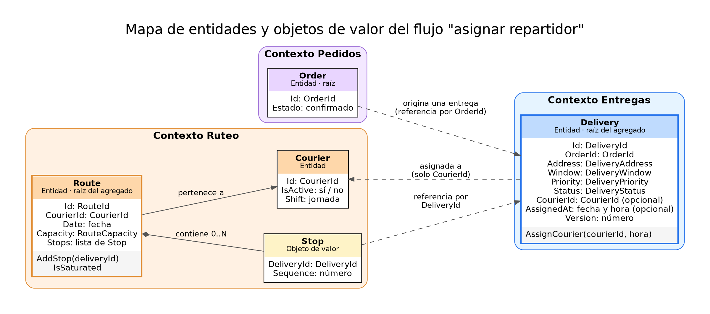
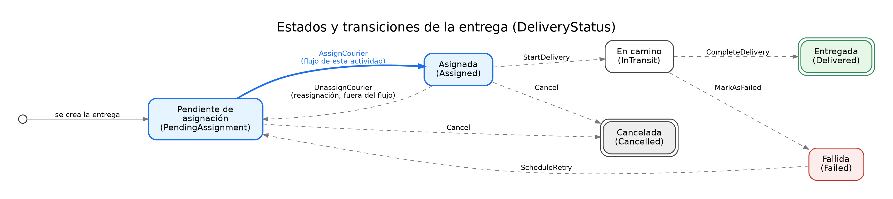

# Modelo de dominio

## 1. Introducción

Este documento modela los conceptos del flujo **asignar un repartidor a una entrega** (`01-flujo-de-negocio.md`) con los términos del glosario (`02-lenguaje-ubicuo.md`). Define qué conceptos son **entidades** y cuáles **objetos de valor**, cómo se agrupan en **agregados**, qué **estados** tiene la entrega y qué **eventos** produce.

El modelo pertenece al dominio: no conoce bases de datos, servicios externos ni frameworks.

> Los nombres en código siguen el glosario. Los tipos de datos se describen de forma conceptual, no con un lenguaje concreto.

## 2. Cómo se decide entre entidad y objeto de valor

| Pregunta | Entidad | Objeto de valor |
|----------|---------|-----------------|
| ¿Tiene identidad propia que persiste en el tiempo? | Sí | No |
| ¿Dos objetos con los mismos atributos son el mismo? | No: se distinguen por su identidad | Sí: se distinguen solo por sus atributos |
| ¿Cambia con el tiempo? | Sí, conserva su identidad | No: se reemplaza por otro valor |
| Ejemplo | Dos entregas a la misma dirección y con la misma ventana siguen siendo dos entregas | Dos direcciones con el mismo texto son la misma dirección |

## 3. Mapa de entidades

Cada contexto tiene su propio modelo. Los objetos de contextos distintos **se referencian solo por identificador**, nunca por un enlace directo: `Delivery` guarda el `CourierId`, pero no conoce al repartidor.

## 4. Entidades

| Entidad | Contexto | Rol | Identidad | Qué protege |
|---------|----------|-----|-----------|-------------|
| **Delivery** | Entregas | Raíz del agregado. Representa el compromiso de llevar un pedido a una dirección | `DeliveryId` | Su propio estado y que tenga un solo repartidor activo |
| **Route** | Ruteo | Raíz del agregado. Conjunto de paradas de un repartidor en una jornada | `RouteId` | Que no supere su capacidad |
| **Courier** | Ruteo | Repartidor como recurso con jornada y capacidad | `CourierId` | Su condición de activo |
| **Order** | Pedidos | Raíz del agregado. Solicitud de compra confirmada | `OrderId` | Fuera del alcance de este diseño; solo origina la entrega |

### Atributos de `Delivery`

| Atributo | Tipo | Obligatorio | Descripción |
|----------|------|-------------|-------------|
| `Id` | `DeliveryId` | Sí | Identidad de la entrega |
| `OrderId` | `OrderId` | Sí | Pedido que la origina (referencia) |
| `Address` | `DeliveryAddress` | Sí | Dirección de entrega |
| `Window` | `DeliveryWindow` | Sí | Ventana prometida |
| `Priority` | `DeliveryPriority` | Sí | Urgencia |
| `Status` | `DeliveryStatus` | Sí | Estado actual |
| `CourierId` | `CourierId` | No | Repartidor activo, vacío mientras esté pendiente |
| `AssignedAt` | Fecha y hora | No | Momento de la asignación |
| `Version` | Número | Sí | Control de concurrencia (ver sección 8) |

### Comportamiento de `Delivery`

| Operación | Efecto |
|-----------|--------|
| `AssignCourier(courierId, hora)` | Asigna el repartidor si la entrega está pendiente y no tiene repartidor activo; cambia el estado a *Asignada* y registra el evento `DeliveryAssigned` |

Las demás operaciones (`UnassignCourier`, `StartDelivery`, `CompleteDelivery`, `MarkAsFailed`, `ScheduleRetry`, `Cancel`) aparecen en el diagrama de estados, pero **quedan fuera del flujo** de esta actividad.

## 5. Objetos de valor

| Objeto de valor | Atributos | Reglas de validez | Por qué es objeto de valor |
|-----------------|-----------|-------------------|----------------------------|
| `DeliveryId` | Valor único | No puede estar vacío | Solo importa su valor, sirve para distinguir entregas |
| `CourierId` | Valor único | No puede estar vacío | Igual que el anterior |
| `RouteId` | Valor único | No puede estar vacío | Igual que el anterior |
| `OrderId` | Valor único | No puede estar vacío | Igual que el anterior |
| `DeliveryAddress` | Texto de la dirección | No puede estar vacío; se guarda normalizada | Dos direcciones iguales son intercambiables |
| `DeliveryWindow` | Inicio y fin | El inicio es anterior al fin | Un intervalo se reemplaza, no se modifica |
| `DeliveryPriority` | Nivel (normal, urgente) | Solo valores permitidos | Es una clasificación sin identidad |
| `DeliveryStatus` | Estado (enumeración) | Solo los seis estados definidos | Describe una situación, no un objeto |
| `Stop` | `DeliveryId` y posición | La posición es un número positivo | Describe un punto dentro de una ruta, sin vida propia |
| `RouteCapacity` | Máximo de paradas | Entero mayor que cero (supuesto A3-S02) | Es una cantidad con una regla de validez |
| `CourierAvailability` | Disponible sí o no, y motivo | El motivo es obligatorio si no está disponible | Es la respuesta de una consulta, no un objeto con historia |

**Características comunes:** son inmutables, se comparan por valor y validan su propia consistencia al crearse. Un valor inválido no puede existir.

## 6. Agregados y límites de consistencia

Un agregado agrupa los objetos que deben ser consistentes entre sí en una sola operación. Solo se accede a él a través de su raíz.

| Agregado | Raíz | Contenido | Regla que garantiza |
|----------|------|-----------|---------------------|
| **Entrega** | `Delivery` | La entrega y sus valores | Un solo repartidor activo; transiciones de estado válidas |
| **Ruta** | `Route` | La ruta y sus `Stop` | No superar la capacidad |

**Decisiones:**

- **Agregados pequeños.** `Delivery` y `Route` son agregados separados y se vinculan solo por identificadores, lo que evita bloquear toda la ruta al modificar una entrega.
- **`Courier` no está dentro de `Delivery`.** La entrega solo necesita saber quién la tiene, no los datos del repartidor.
- **La capacidad pertenece a `Route`.** Es Ruteo quien conoce cuántas paradas admite una ruta, no Entregas.

## 7. Estados y transiciones de la entrega

| Desde | Hasta | Operación | Condición | ¿En este flujo? |
|-------|-------|-----------|-----------|-----------------|
| (inicio) | Pendiente de asignación | Crear entrega | Pedido confirmado | No |
| **Pendiente de asignación** | **Asignada** | **`AssignCourier`** | **No tiene repartidor activo** | **Sí** |
| Asignada | Pendiente de asignación | `UnassignCourier` | Aún no salió a la calle | No (reasignación) |
| Asignada | En camino | `StartDelivery` | El repartidor inicia la ruta | No |
| En camino | Entregada | `CompleteDelivery` | Hay evidencia de recepción | No |
| En camino | Fallida | `MarkAsFailed` | Se registra el motivo | No |
| Fallida | Pendiente de asignación | `ScheduleRetry` | Se autoriza un reintento | No |
| Pendiente de asignación | Cancelada | `Cancel` | Pedido cancelado | No |
| Asignada | Cancelada | `Cancel` | Pedido cancelado | No |

**Estados finales:** *Entregada* y *Cancelada*. Desde ellos no hay más transiciones.

**Transiciones que no existen** (y son errores): asignar desde *Asignada*, *En camino*, *Entregada*, *Fallida* o *Cancelada*; cancelar una entrega que ya está *En camino*; pasar de *Pendiente* a *En camino* sin asignación.

Para el flujo de esta actividad solo se diseña a fondo la transición **Pendiente de asignación → Asignada**. Las demás se enumeran para que el modelo sea coherente con el ciclo de vida completo.

## 8. Eventos de dominio

| Evento | Cuándo ocurre | Datos |
|--------|---------------|-------|
| `DeliveryAssigned` | Una entrega pasa a *Asignada* | `DeliveryId`, `CourierId`, `AssignedAt`, quién solicitó la asignación |

El evento alimenta el **historial de eventos** (RF16, quién, qué y cuándo) y la solicitud de **notificación** al repartidor. El dominio lo genera; lo que ocurre con él (guardarlo, publicarlo, notificar) lo decide la capa de aplicación (ver `06-casos-de-uso-puertos-adaptadores.md`).

## 9. Decisiones de modelado

| Decisión | Razón | Trade-off |
|----------|-------|-----------|
| **Referencias entre agregados y contextos solo por identificador** | Mantiene los límites claros y evita acoplar los modelos | Obtener datos de otro contexto exige una consulta explícita |
| **La entidad protege sus propias reglas** | La regla "un solo repartidor" no debe depender de quién llame ni de la base de datos | La entidad solo conoce lo que está dentro de su agregado |
| **La hora entra como parámetro** | El dominio no consulta el reloj del sistema, lo que lo hace predecible y fácil de probar | El llamador debe proporcionar la hora |
| **`Version` en `Delivery` para control de concurrencia** | Evita que dos coordinadores asignen la misma entrega a la vez (flujo alterno A7) | Un intento simultáneo se rechaza y debe repetirse |
| **Estados como enumeración con transiciones controladas por la entidad** | Evita estados contradictorios con una estructura simple | Si el ciclo de vida crece mucho, convendría modelar cada estado con más detalle |
| **La capacidad de ruta vive en `Route`, no en `Delivery`** | Es una regla de Ruteo, y `Delivery` no debe conocerla | Una asignación toca dos agregados, y su coordinación se resuelve en la capa de aplicación (paso 6) y se justifica en el ADR |

La coordinación entre `Delivery` y `Route` es la decisión más delicada de este modelo: si solo se consultara la disponibilidad antes de asignar, dos asignaciones simultáneas podrían superar la capacidad. Cómo se evita eso queda para el paso 6 y para el ADR.

## 10. Reglas que se formalizan en el paso siguiente

Este modelo hace posibles las invariantes de `04-invariantes-y-escenarios.md`:

| Invariante candidata | La protege |
|----------------------|------------|
| Una entrega no tiene más de un repartidor activo | `Delivery` |
| Solo se asigna una entrega pendiente | `Delivery` |
| Una entrega no está en dos estados contradictorios | `Delivery` |
| Una ruta no supera su capacidad | `Route` |
| No se asigna a un repartidor inactivo | `Courier` y la consulta de disponibilidad |
| Toda asignación queda registrada | El evento `DeliveryAssigned` y el historial |

## 11. Qué falta confirmar

1. Si la capacidad de ruta se mide solo en paradas (A3-S02).
2. Si una entrega siempre corresponde a un pedido completo (una por pedido).
3. Si desde *Asignada* se puede pasar directamente a *Cancelada*.
4. Qué pasa con una entrega *Fallida*: si vuelve a pendiente o se cierra.
5. Si se necesita guardar quién asignó, además del evento.
