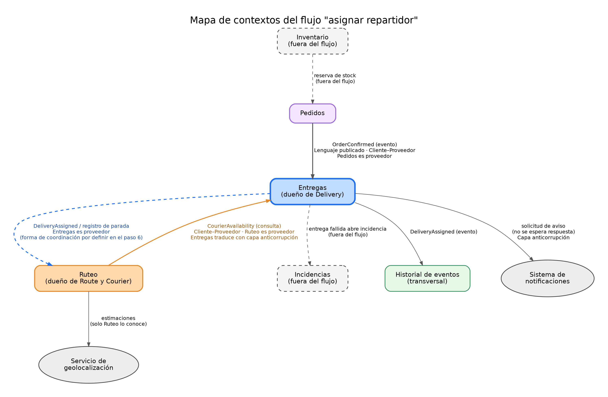

# Contextos y contratos

## 1. Introducción

Un contexto delimitado (*bounded context*) es una frontera dentro de la cual un modelo y su lenguaje tienen un significado único y preciso. Debido a esto, un mismo término puede significar cosas distintas en contextos diferentes sin generar confusión, siempre y cuando la información que cruza la frontera se intercambie mediante contratos explícitos.

Este documento delimita los contextos que participan en el flujo **asignar un repartidor a una entrega** (`01-flujo-de-negocio.md`), representa sus relaciones en un mapa de contextos y define los contratos mediante los cuales intercambian información. Se apoya en el glosario de `02-lenguaje-ubicuo.md` y en el modelo de `03-modelo-de-dominio.md`.

Los contextos se corresponden con los módulos del monolito modular decidido en el ADR-001. En consecuencia, las fronteras que aquí se definen son también las fronteras entre módulos.

## 2. Contextos involucrados

| Contexto | Responsabilidad | Es dueño de | Participación en el flujo |
|----------|-----------------|-------------|---------------------------|
| **Entregas** | Gestionar el ciclo de vida de cada entrega | `Delivery`, `DeliveryStatus` y sus reglas | **Principal**: ejecuta la asignación |
| **Ruteo** | Conocer repartidores, rutas, disponibilidad y capacidad | `Route`, `Courier`, `RouteCapacity` | **Principal**: informa la disponibilidad y registra la parada |
| **Pedidos** | Gestionar la solicitud de compra y su confirmación | `Order` | **Origen**: informa que existe un pedido confirmado |
| **Inventario** | Gestionar existencias y reservas | `StockReservation` | **Fuera del flujo**: ya resolvió la reserva antes de confirmar el pedido |
| **Incidencias** | Gestionar novedades y reclamos | `Incident` | **Fuera del flujo**: puede originarse a partir de una entrega fallida |
| **Historial de eventos** | Registrar qué ocurre con cada pedido | `EventLog` | **Transversal**: recibe el evento de la asignación |

Además, participan dos sistemas externos: el **servicio de geolocalización**, que solo conoce Ruteo, y el **sistema de notificaciones**, al que Entregas solicita los avisos.

## 3. Mapa de contextos

La dirección de las flechas indica quién entrega información a quién. En las relaciones cliente–proveedor, el proveedor (*upstream*) define el contrato y el cliente (*downstream*) se adapta a él.

| Relación | Proveedor | Cliente | Patrón | Qué significa |
|----------|-----------|---------|--------|---------------|
| Pedidos → Entregas | Pedidos | Entregas | Lenguaje publicado y cliente–proveedor | Pedidos publica un evento con un formato estable, y Entregas lo consume |
| Ruteo → Entregas | Ruteo | Entregas | Cliente–proveedor con capa anticorrupción | Entregas consulta la disponibilidad y traduce la respuesta a su propio lenguaje |
| Entregas → Ruteo | Entregas | Ruteo | Cliente–proveedor | Ruteo necesita saber qué entrega fue asignada para registrar la parada |
| Entregas → Historial | Entregas | Historial | Lenguaje publicado | El historial registra el evento tal como se publica |
| Entregas → Notificaciones | Entregas | Notificaciones (externo) | Capa anticorrupción | Entregas solicita el aviso sin depender del proveedor concreto |
| Ruteo → Geolocalización | Geolocalización | Ruteo | Capa anticorrupción | Solo Ruteo conoce el servicio de geolocalización |

### Observación sobre la relación entre Entregas y Ruteo

Entregas y Ruteo dependen el uno del otro: Entregas necesita la disponibilidad de Ruteo, y Ruteo necesita saber qué entregas fueron asignadas. Esta dependencia mutua es un riesgo, porque puede generar un acoplamiento circular entre módulos. Para controlarlo se aplican dos medidas:

1. Cada contexto expone un **paquete de contratos** (consultas, comandos y eventos) y los demás contextos dependen únicamente de ese paquete, nunca de su interior.
2. La consulta de disponibilidad y el evento de asignación son **contratos distintos**, cada uno con su dueño y su versión.

## 4. Contratos entre contextos

Cada contrato indica qué información viaja, en qué dirección, con qué garantías y cómo se versiona. Los contratos se describen de forma conceptual, sin lenguaje de programación ni protocolo.

### C1. Pedidos → Entregas: `OrderConfirmed`

| Aspecto | Detalle |
|---------|---------|
| **Tipo** | Evento |
| **Significado** | Un pedido quedó confirmado: el pago está verificado y el inventario, reservado |
| **Versión** | v1 |
| **Datos** | Identificador del pedido, dirección de entrega (texto), ventana de entrega (inicio y fin), prioridad, fecha y hora de la confirmación |
| **Reacción de Entregas** | Crea una entrega en estado *Pendiente de asignación* |
| **Garantías** | Puede entregarse más de una vez, por lo que Entregas debe ser **idempotente**: un mismo pedido no genera dos entregas |
| **Fuera del contrato** | Líneas del pedido, datos de pago e inventario: a Entregas no le corresponden |

### C2. Entregas → Ruteo: consulta de `CourierAvailability`

| Aspecto | Detalle |
|---------|---------|
| **Tipo** | Consulta síncrona |
| **Significado** | ¿Puede este repartidor recibir otra entrega? |
| **Versión** | v1 |
| **Entrada** | Identificador del repartidor |
| **Salida** | Disponible (sí o no) y, si no lo está, el motivo: repartidor inactivo, fuera de jornada o ruta saturada |
| **Tiempo máximo de espera** | Definido por Entregas (supuesto: 2 segundos). Si se supera, se trata como falla |
| **Falla** | Entregas no asigna y responde con el rechazo `AVAILABILITY_UNVERIFIABLE` (política POL01) |
| **Fuera del contrato** | Capacidad, número de paradas y detalles de la ruta: Entregas no los necesita |

### C3. Entregas → Ruteo: asignación y registro de la parada

| Aspecto | Detalle |
|---------|---------|
| **Significado** | Ruteo debe registrar que la entrega es una nueva parada en la ruta del repartidor |
| **Datos** | Identificador de la entrega, identificador del repartidor, momento de la asignación, quién la solicitó |
| **Forma de coordinación** | **Decisión abierta** entre las dos alternativas siguientes |

| Alternativa | Descripción | Ventaja | Desventaja |
|-------------|-------------|---------|------------|
| **a. Evento posterior** | Entregas asigna, publica `DeliveryAssigned` y Ruteo registra la parada después | Contextos más independientes | Si Ruteo rechaza la parada por capacidad, hay que revertir la asignación |
| **b. Operación única** | La asignación y el registro de la parada ocurren juntos, en una sola operación consistente | La capacidad nunca se supera y no hay reversión | Entregas y Ruteo quedan más acoplados en el momento de la operación |

La alternativa **b** está alineada con la regla 3 del ADR-001, que pide operaciones consistentes dentro del monolito, y resuelve el escenario concurrente EA12. Sin embargo, la decisión definitiva se toma en el paso 6 y se justifica en el ADR.

### C4. Entregas → Historial: `DeliveryAssigned`

| Aspecto | Detalle |
|---------|---------|
| **Tipo** | Evento |
| **Significado** | A una entrega se le asignó un repartidor |
| **Versión** | v1 |
| **Datos** | Identificador de la entrega, identificador del repartidor, momento de la asignación, quién la solicitó |
| **Reacción del historial** | Agrega un registro con quién, qué y cuándo (INV06) |
| **Garantías** | El evento se genera únicamente si la asignación se completó |

### C5. Entregas → Notificaciones: solicitud de aviso

| Aspecto | Detalle |
|---------|---------|
| **Tipo** | Comando, sin esperar respuesta |
| **Significado** | Se solicita avisar al repartidor que tiene una nueva entrega |
| **Versión** | v1 |
| **Datos** | Destinatario (identificador del repartidor), tipo de aviso (nueva entrega asignada) y la entrega a la que se refiere |
| **Falla** | **No revierte la asignación.** El aviso se reintenta o se registra como pendiente |
| **Fuera del contrato** | El canal (mensaje, correo, notificación en la aplicación) lo decide el sistema de notificaciones |

La razón de no revertir la asignación es que una falla de un tercero no debe detener la operación (escenarios QS08 y QS09 de la Actividad 2).

## 5. Contrato de entrada del caso de uso

El coordinador se comunica con la plataforma mediante un **contrato de aplicación**, distinto de los contratos entre contextos. Su definición detallada (datos de entrada, resultado y errores) corresponde a `06-casos-de-uso-puertos-adaptadores.md`. A continuación, el resumen de los errores que cualquier consumidor puede recibir:

| Código | Cuándo ocurre | Regla |
|--------|---------------|-------|
| `DELIVERY_NOT_FOUND` | La entrega no existe | PRE01 |
| `DELIVERY_ALREADY_ASSIGNED` | La entrega ya tiene un repartidor activo | INV01 |
| `DELIVERY_NOT_PENDING` | La entrega no está pendiente de asignación | INV02 |
| `COURIER_NOT_ACTIVE` | El repartidor está inactivo | INV05 |
| `ROUTE_SATURATED` | La ruta alcanzó su capacidad | INV04 |
| `AVAILABILITY_UNVERIFIABLE` | No se pudo verificar la disponibilidad | POL01 |

Estos códigos son estables: los consumidores pueden depender de ellos, mientras que los mensajes de texto pueden cambiar.

## 6. Traducción entre contextos

Para que el modelo de un contexto no se contamine con el de otro, cada traducción se realiza en la frontera.

| Información | En el contexto de origen | En el contexto de destino |
|-------------|--------------------------|---------------------------|
| Disponibilidad | Ruteo: repartidor activo, en jornada y con ruta no saturada | Entregas: "disponible" o "no disponible" con motivo; no conoce rutas ni capacidades |
| Pedido confirmado | Pedidos: `Order` con líneas, pagos y reservas | Entregas: una `Delivery` con dirección, ventana y prioridad |
| Repartidor | Ruteo: `Courier` con jornada y capacidad | Entregas: solo un `CourierId` |
| Estado | Pedidos: ciclo de vida del pedido | Entregas: `DeliveryStatus` |

Esta traducción es la **capa anticorrupción**: un componente en la frontera que convierte los datos del contexto vecino al lenguaje propio, de modo que el dominio de Entregas nunca vea los tipos de Ruteo ni de Pedidos.

## 7. Reglas de dependencia entre contextos

| Regla | Explicación |
|-------|-------------|
| **Solo por contratos** | Un contexto accede a otro únicamente mediante su paquete de contratos |
| **Sin acceso a datos ajenos** | Ningún contexto lee ni escribe los datos de otro directamente |
| **Referencias por identificador** | Los objetos de contextos distintos se vinculan solo por su identificador |
| **Sin entidades compartidas** | Cada contexto tiene su propio modelo, aunque dos contextos usen palabras iguales |
| **Contratos versionados** | Un cambio incompatible genera una nueva versión, y la anterior se mantiene mientras haya consumidores |

Estas reglas desarrollan la regla 2 del ADR-001 y el criterio verificable CE02 de la Actividad 2.

## 8. Decisiones de diseño

| Decisión | Razón | Trade-off |
|----------|-------|-----------|
| **Entregas no consulta a Inventario** | La reserva ya se resolvió antes de confirmar el pedido; consultarla de nuevo duplicaría la responsabilidad | Si se libera una reserva después de confirmar, Entregas no se entera sin un evento adicional |
| **Entregas crea la entrega al recibir `OrderConfirmed`** | Entregas es dueño de `Delivery`, y Pedidos no debe conocer su estructura | Entregas depende de que el evento llegue |
| **Consulta de disponibilidad síncrona con tiempo máximo** | El coordinador necesita una respuesta inmediata para decidir | Si Ruteo no responde, la asignación se rechaza |
| **Aviso sin esperar respuesta** | Una falla del sistema de notificaciones no debe impedir la asignación | El repartidor podría enterarse tarde si el aviso falla |
| **Paquete de contratos por contexto** | Evita el acoplamiento circular entre Entregas y Ruteo | Exige mantener y versionar los contratos |
| **Capa anticorrupción en cada frontera** | Protege el lenguaje de cada contexto | Agrega componentes de traducción |

## 9. Relación con los documentos anteriores

| Documento | Cómo se relaciona |
|-----------|-------------------|
| `docs/actividad-2/adr/ADR-001-estructura-de-la-plataforma.md` | Los contextos son los módulos del monolito modular; las reglas 2, 3, 4 y 5 aplican a estas fronteras |
| `docs/actividad-2/05-criterios-verificables.md` | CE02, CE04 y CE05 verifican estas fronteras y contratos |
| `docs/actividad-2/03-escenarios-de-calidad.md` | QS08, QS09 y QS12 respaldan las decisiones sobre fallas y versiones |
| `02-lenguaje-ubicuo.md` | Define los términos que no deben mezclarse entre contextos |
| `04-invariantes-y-escenarios.md` | Las reglas INV01 a INV07 se protegen dentro de cada contexto |

## 10. Qué falta confirmar

1. La forma definitiva de coordinar la asignación y el registro de la parada (C3), que se decide en el paso 6 y en el ADR.
2. Si Entregas debe enterarse cuando se libera una reserva de inventario después de confirmar el pedido.
3. El tiempo máximo de espera de la consulta de disponibilidad (supuesto de 2 segundos).
4. Qué ocurre con el repartidor asignado en las entregas *Entregada*, *Fallida* y *Cancelada*: el documento 04 solo define esa coherencia para los estados *Pendiente de asignación*, *Asignada* y *En camino*. Queda como punto abierto.
5. Si Incidencias necesita enterarse de una entrega fallida y mediante qué contrato, cuestión que queda fuera de este flujo.
