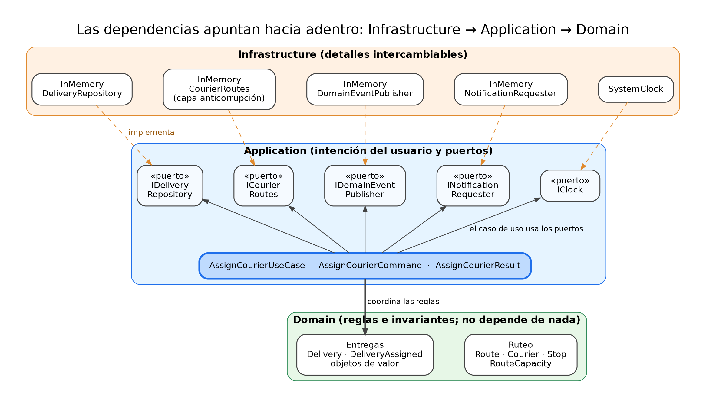

# Casos de uso, puertos y adaptadores

## 1. Introducción

Este documento diseña el caso de uso **asignar un repartidor a una entrega** (`AssignCourierUseCase`), define sus contratos de aplicación, sus puertos y sus adaptadores, y muestra cómo se separan el dominio, la aplicación y la infraestructura. El diseño se acompaña de un esqueleto de código en C# con sus pruebas, que sirve para demostrar que la separación es real y que las reglas de `04-invariantes-y-escenarios.md` pueden comprobarse sin base de datos ni servicios externos.

Se parte de lo decidido en los documentos anteriores: el modelo de `03-modelo-de-dominio.md`, los contextos y contratos de `05-contextos-y-contratos.md` y la estructura de monolito modular del ADR-001.

> El código no implementa persistencia ni integraciones reales. Esas piezas corresponden a la Actividad 4 y aquí se representan con adaptadores en memoria.

## 2. Capas y dirección de las dependencias



| Capa | Responsabilidad | Depende de | No puede depender de |
|------|-----------------|------------|----------------------|
| **Domain** | Reglas e invariantes del negocio: entidades, objetos de valor, eventos y errores de dominio | Nada | Aplicación, infraestructura, frameworks, bases de datos |
| **Application** | Casos de uso, contratos de entrada y salida, y los puertos que expresan lo que el caso de uso necesita | Domain | Infraestructura |
| **Infrastructure** | Adaptadores que implementan los puertos con tecnologías concretas | Application (y Domain por transitividad) | Nada que lo requiera: nadie depende de ella |

**Regla de inversión de dependencias:** la aplicación define el puerto y la infraestructura lo implementa. Por eso la flecha de dependencia de un adaptador apunta hacia el puerto, y no al revés. Esta regla se verifica a nivel de proyectos: `Domain` no referencia a ningún proyecto, `Application` referencia solo a `Domain`, e `Infrastructure` referencia solo a `Application`. Si alguien intentara usar una clase de infraestructura dentro del dominio, el código no compilaría.

## 3. El caso de uso `AssignCourier`

### Intención

Asignar un repartidor a una entrega pendiente, cuidando que se cumplan las reglas del negocio y que el resultado quede registrado.

### Pasos

| Paso | Qué hace | Quién lo resuelve |
|------|----------|-------------------|
| 1 | Cargar la entrega mediante `IDeliveryRepository` | Aplicación, mediante un puerto |
| 2 | Verificar que exista (PRE01) | Aplicación |
| 3 | Consultar la disponibilidad del repartidor mediante `ICourierRoutes` (INV05, POL01) | Aplicación, mediante un puerto |
| 4 | Ejecutar `delivery.AssignCourier(courierId, hora, solicitante)` (INV01, INV02, INV03) | **Dominio** |
| 5 | Reservar el cupo en la ruta mediante `ICourierRoutes` (INV04) | Ruteo, mediante un puerto |
| 6 | Guardar la entrega; si hay conflicto, liberar el cupo | Aplicación y puerto |
| 7 | Registrar el evento `DeliveryAssigned` mediante `IDomainEventPublisher` (INV06) | Aplicación, mediante un puerto |
| 8 | Solicitar el aviso al repartidor mediante `INotificationRequester` | Aplicación, mediante un puerto |

El flujo sigue los pasos que plantea el enunciado, con dos ajustes: se agrega la reserva del cupo (paso 5) para proteger la capacidad de la ruta, y la solicitud del aviso (paso 8) queda separada del registro del evento.

### Lo que el caso de uso no hace

- No contiene reglas de negocio: "una entrega no puede tener dos repartidores" vive en `Delivery`, y "una ruta no supera su capacidad" vive en `Route`.
- No crea conexiones, clientes de servicios ni clases de infraestructura.
- No conoce HTTP, base de datos ni formatos de mensaje.

## 4. Contratos de aplicación

El contrato usa tipos simples, sin objetos del dominio, para que quien lo invoque (una API, una pantalla o una prueba) no dependa del modelo.

### Entrada: `AssignCourierCommand`

| Campo | Tipo | Descripción |
|-------|------|-------------|
| `DeliveryId` | Identificador | Entrega a asignar |
| `CourierId` | Identificador | Repartidor elegido |
| `RequestedBy` | Texto | Quién solicita la asignación, necesario para el historial (INV06) |

### Salida: `AssignCourierResult`

| Campo | Descripción |
|-------|-------------|
| `IsSuccess` | Indica si la asignación se completó |
| `ErrorCode` | Código estable del rechazo; vacío si hubo éxito |
| `ErrorMessage` | Mensaje legible para el coordinador |
| `AssignedAt` | Momento de la asignación, si hubo éxito |
| `NoticeRequested` | Indica si se logró solicitar el aviso al repartidor |

Un rechazo de negocio es un **resultado esperado**, no una excepción. Las excepciones se reservan para fallas inesperadas.

### Códigos de rechazo

| Código | Cuándo ocurre | Regla | Escenarios |
|--------|---------------|-------|------------|
| `DELIVERY_NOT_FOUND` | La entrega no existe | PRE01 | EA06 |
| `DELIVERY_ALREADY_ASSIGNED` | La entrega ya tiene un repartidor activo, o fue asignada por otra operación al mismo tiempo | INV01 | EA02, EA03, EA11 |
| `DELIVERY_NOT_PENDING` | La entrega no está pendiente de asignación | INV02 | EA04 |
| `COURIER_NOT_ACTIVE` | El repartidor está inactivo o fuera de jornada | INV05 | EA08 |
| `ROUTE_SATURATED` | La ruta alcanzó su capacidad | INV04 | EA09, EA12 |
| `AVAILABILITY_UNVERIFIABLE` | No se pudo verificar la disponibilidad | POL01 | EA07 |

Los códigos son los mismos definidos en `05-contextos-y-contratos.md`.

## 5. Puertos

Un puerto expresa **lo que el caso de uso necesita**, en lenguaje del negocio y sin mencionar tecnologías. Todos los puertos se definen en la capa de aplicación.

| Puerto | Necesidad que expresa | Contrato | Adaptador en esta actividad | Adaptador previsto en la Actividad 4 |
|--------|----------------------|----------|-----------------------------|--------------------------------------|
| `IDeliveryRepository` | Obtener y guardar entregas, con control de concurrencia | Interno | `InMemoryDeliveryRepository` | Repositorio sobre una base de datos |
| `ICourierRoutes` | Consultar la disponibilidad de un repartidor, reservar un cupo y liberarlo | C2 y C3 | `InMemoryCourierRoutes` | Adaptador que usa la interfaz pública del módulo Ruteo |
| `IDomainEventPublisher` | Registrar los hechos ocurridos | C4 | `InMemoryDomainEventPublisher` | Registro persistente del historial |
| `INotificationRequester` | Solicitar un aviso al repartidor | C5 | `InMemoryNotificationRequester` | Adaptador hacia el sistema de notificaciones |
| `IClock` | Obtener la hora actual | Interno | `SystemClock` | El mismo |

**Dos detalles de diseño del puerto de Ruteo:**

- `CourierAvailability` es la respuesta de Ruteo **expresada en el lenguaje de Entregas**: disponible o no, con un motivo. Entregas no conoce rutas, capacidades ni paradas.
- Si Ruteo no responde, el adaptador lanza una excepción propia del puerto, y el caso de uso la traduce al rechazo `AVAILABILITY_UNVERIFIABLE`. Así la política de no asignar a ciegas (POL01) está en un solo lugar.

## 6. Adaptadores

| Adaptador | Qué hace | Detalle relevante |
|-----------|----------|-------------------|
| `InMemoryDeliveryRepository` | Guarda copias de las entregas en memoria | Controla la concurrencia con un número de versión, como lo haría una base real |
| `InMemoryCourierRoutes` | Representa el contrato público de Ruteo | Traduce `Route` y `Courier` a "disponible o no". Es la capa anticorrupción |
| `InMemoryDomainEventPublisher` | Guarda los eventos como un historial simple | Permite comprobar qué se registró |
| `InMemoryNotificationRequester` | Registra los avisos solicitados | Permite comprobar que se pidió el aviso |
| `SystemClock` | Entrega la hora del sistema | Es el único lugar que consulta el reloj |

Los adaptadores en memoria no son un atajo: permiten probar el flujo completo, incluida la concurrencia, sin infraestructura real. Reemplazarlos por adaptadores reales en la Actividad 4 no exige modificar el dominio ni el caso de uso.

## 7. Decisión de diseño: cómo se coordinan la entrega y la ruta

El documento `05-contextos-y-contratos.md` dejó abierta la forma de coordinar la asignación de la entrega con el registro de la parada en la ruta (contrato C3). El problema es que la asignación toca dos agregados distintos, y si solo se consulta la disponibilidad antes de asignar, dos asignaciones simultáneas podrían superar la capacidad de la ruta (escenario EA12).

| Alternativa | Descripción | Ventaja | Desventaja |
|-------------|-------------|---------|------------|
| **A. Evento posterior** | Entregas asigna y Ruteo registra la parada después | Contextos más independientes | Si Ruteo no tiene cupo, hay que revertir una asignación ya confirmada |
| **B. Transacción única** | Un solo almacenamiento y una sola transacción cubren ambos agregados | Máxima consistencia | Acopla el almacenamiento de dos módulos y limita su separación futura |
| **C. Reserva previa con liberación compensatoria** *(elegida)* | Ruteo reserva el cupo de forma atómica antes de guardar la entrega; si el guardado falla, se libera | Ruteo protege su capacidad por sí mismo y no se asigna sin cupo | Exige una operación de liberación y cuidar que sea segura |

**Decisión:** se adopta la alternativa C. Es una variante de la alternativa "operación única" que anticipó el documento 05: ambas partes ocurren dentro de una misma operación del caso de uso, sin acoplar el almacenamiento de los módulos.

**Justificación:**

- La capacidad de la ruta se protege dentro del propio agregado `Route`, que es quien conoce la regla (INV04).
- El estado de la entrega se protege con el control de versión, que evita la doble asignación (INV01).
- Ninguna operación deja cambios a medias: si no hay cupo, no se guarda nada, y si el guardado falla, se libera el cupo.

**Trade-offs:** se agrega una operación (`ReleaseStopAsync`) que debe ser segura aunque se repita, y la consistencia depende de que la liberación se ejecute. A cambio, se evita acoplar módulos y se resuelve EA12 de forma verificable.

## 8. Otras decisiones de diseño

| Decisión | Razón | Trade-off |
|----------|-------|-----------|
| **Los rechazos de negocio son resultados, no excepciones** | Son situaciones previstas; el consumidor recibe un código estable | El consumidor debe revisar el resultado en lugar de capturar errores |
| **El dominio recibe la hora y quién solicita como parámetros** | No consulta el reloj del sistema, lo que lo hace predecible y fácil de probar | El llamador debe proporcionarlos |
| **Control de concurrencia con versión, gestionado por el adaptador** | El dominio no se ocupa de cómo se evita la doble escritura | Un intento simultáneo se rechaza y debe repetirse |
| **El aviso no revierte la asignación** | Una falla de un tercero no debe detener la operación (QS09) | El repartidor podría enterarse tarde |
| **El evento se registra después de guardar** | Mantiene simple el flujo en esta etapa | Si el registro falla, la entrega queda asignada sin evento. En la Actividad 4 se mitigará guardando el evento junto con la entrega y publicándolo después |
| **Identificadores compartidos como núcleo mínimo** | Permiten referenciar objetos de otros contextos sin acoplar sus modelos | Es lo único compartido y debe mantenerse pequeño |
| **`CourierAvailability` vive en Application** | Es la respuesta de un puerto, no una regla del dominio de Entregas | Ninguno relevante |
| **Adaptadores en memoria en esta actividad** | Permiten probar el flujo sin infraestructura | No demuestran el comportamiento de una base real |

Estas decisiones, junto con la elección del lenguaje, se registran en el ADR de esta actividad.

## 9. Estructura del código

```
logistica-ultima-milla/
├── Directory.Build.props
├── .gitignore
├── src/
│   ├── Domain/
│   │   ├── Shared/          Identificadores, eventos y errores base
│   │   ├── Entregas/        Delivery, DeliveryStatus, objetos de valor, DeliveryAssigned
│   │   └── Ruteo/           Route, Courier, Stop, RouteCapacity
│   ├── Application/
│   │   ├── Ports/           IDeliveryRepository, ICourierRoutes, IDomainEventPublisher,
│   │   │                    INotificationRequester, IClock
│   │   └── Entregas/        AssignCourierUseCase, AssignCourierCommand, AssignCourierResult
│   └── Infrastructure/
│       ├── Persistence/     InMemoryDeliveryRepository
│       ├── Routing/         InMemoryCourierRoutes
│       ├── Events/          InMemoryDomainEventPublisher
│       ├── Notifications/   InMemoryNotificationRequester
│       └── Time/            SystemClock
└── tests/
    ├── Domain.Tests/        Pruebas unitarias del dominio
    ├── Application.Tests/   Pruebas del caso de uso con dobles de los puertos
    └── Integration.Tests/   Pruebas del flujo con los adaptadores en memoria
```

### Del modelo al código

| Concepto del modelo | Dónde está |
|---------------------|------------|
| `Delivery` y su transición *Pendiente → Asignada* | `src/Domain/Entregas/Delivery.cs` |
| Invariantes INV01 e INV02 | `Delivery.AssignCourier` |
| Invariante INV03 | `Delivery.Restore` y `Delivery.AssignCourier` |
| Invariante INV04 | `src/Domain/Ruteo/Route.cs` (`AddStop`) |
| Invariante INV07 | Constructores de los objetos de valor |
| Evento `DeliveryAssigned` | `src/Domain/Entregas/DeliveryAssigned.cs` |
| Precondición PRE01 y política POL01 | `AssignCourierUseCase` |

## 10. Cómo se comprueban los escenarios

Cada escenario de `04-invariantes-y-escenarios.md` se comprueba en el nivel más bajo posible.

| Escenario | Prueba | Nivel |
|-----------|--------|-------|
| EA01 | `AssignCourier_OnPendingDelivery_BecomesAssignedAndRaisesEvent`, `Execute_WithAvailableCourier_AssignsAndRequestsNotice`, `FullFlow_AssignsDeliveryAndRegistersStopInRoute` | Dominio, aplicación e integración |
| EA02 | `AssignCourier_WhenAlreadyAssigned_Throws`, `Execute_WhenDeliveryAlreadyAssigned_Rejects` | Dominio y aplicación |
| EA03 | `AssignCourier_SameCourierTwice_Throws` | Dominio |
| EA04 | `AssignCourier_WhenNotPending_Throws`, `Execute_WhenDeliveryIsNotPending_Rejects` | Dominio y aplicación |
| EA05 | `NewDelivery_IsPendingWithoutCourier` | Dominio |
| EA06 | `Execute_WhenDeliveryDoesNotExist_Rejects` | Aplicación |
| EA07 | `Execute_WhenAvailabilityCannotBeVerified_DoesNotAssign` | Aplicación |
| EA08 | `Execute_WhenCourierIsNotActive_Rejects` | Aplicación |
| EA09 | `AddStop_OnSaturatedRoute_Throws`, `Execute_WhenRouteIsSaturated_Rejects` | Dominio y aplicación |
| EA10 | `AddStop_TakingLastSlot_RouteBecomesSaturated` | Dominio |
| EA11 | `SimultaneousAssignments_OfSameDelivery_OnlyOneWins` | Integración |
| EA12 | `SimultaneousAssignments_ForLastSlot_OnlyOneWins` | Integración |
| EA13 | `DeliveryWindow_WithStartAfterEnd_Throws` | Dominio |
| EA14 | `RouteCapacity_BelowOne_Throws` | Dominio |
| EA15 | `DeliveryAddress_Empty_Throws` | Dominio |

Además se prueban tres comportamientos propios del diseño: que el aviso fallido no revierte la asignación, que una reserva fallida no guarda la entrega y que un conflicto al guardar libera el cupo reservado.

En total son 38 casos de prueba: 22 del dominio, 13 de la aplicación y 3 de integración. Las pruebas del dominio y de la aplicación no usan base de datos ni servicios reales.

## 11. Cómo construir y probar

Requisito: el SDK de .NET 10 (versión de soporte a largo plazo). Se comprueba con `dotnet --version`.

Desde la raíz del repositorio:

```bash
dotnet new sln -n LogisticaUltimaMilla
dotnet sln add src/Domain/LogisticaUltimaMilla.Domain.csproj
dotnet sln add src/Application/LogisticaUltimaMilla.Application.csproj
dotnet sln add src/Infrastructure/LogisticaUltimaMilla.Infrastructure.csproj
dotnet sln add tests/Domain.Tests/LogisticaUltimaMilla.Domain.Tests.csproj
dotnet sln add tests/Application.Tests/LogisticaUltimaMilla.Application.Tests.csproj
dotnet sln add tests/Integration.Tests/LogisticaUltimaMilla.Integration.Tests.csproj
dotnet build
dotnet test
```

La versión de .NET se define en un solo lugar: `Directory.Build.props`.

## 12. Relación con los documentos anteriores

| Documento | Cómo se relaciona |
|-----------|-------------------|
| `03-modelo-de-dominio.md` | El código implementa las entidades, objetos de valor y estados del modelo |
| `04-invariantes-y-escenarios.md` | Cada escenario tiene su prueba |
| `05-contextos-y-contratos.md` | Los puertos corresponden a los contratos C2 a C5 |
| `docs/actividad-2/adr/ADR-001-estructura-de-la-plataforma.md` | Reglas 2 (dependencias por interfaces), 4 (adaptadores) y 5 (Ruteo aislado) |

## 13. Qué falta confirmar

1. Si la liberación del cupo debe poder repetirse sin efecto (idempotencia) cuando haya persistencia real.
2. Cómo se garantiza en la Actividad 4 que el evento no se pierda si falla su registro.
3. Si el tiempo máximo de espera de la consulta de disponibilidad (supuesto de 2 segundos) corresponde a un valor real.
4. Si la reasignación y la cancelación, que quedaron fuera del flujo, exigirán cambios en los puertos.
