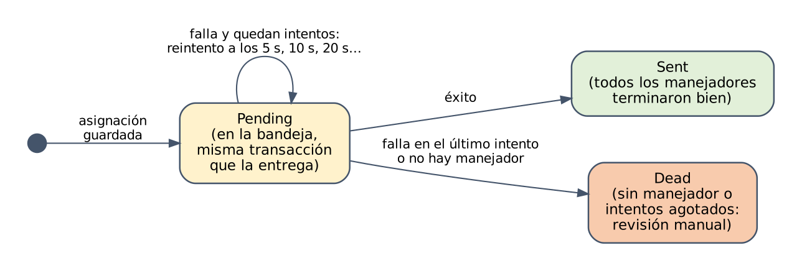

# ADR-007: Bandeja de salida transaccional, reintentos y mensajes muertos

| Campo | Valor |
|-------|-------|
| **Estado** | Aceptada, con revisión periódica (ver sección 8) |
| **Fecha** | 24 de noviembre de 2026 |
| **Autor** | [Tu nombre completo] |
| **Actividad** | Actividad 4: construcción, validación y defensa final |
| **Decisiones relacionadas** | ADR-005 (la ajusta); ADR-004; contratos C4 y C5; plan de implementación AJ-01 a AJ-03, D4-05 y D4-06 |

## 1. Contexto

El ADR-005 decidió registrar el evento después de guardar la entrega y dejó abierto un riesgo: si el registro falla justo después de guardar, la entrega queda asignada **sin evento**. También decidió que un aviso fallido no revierte la asignación, pero no definió cómo se reintenta. La persistencia real de la Actividad 4 permite cerrar ambos puntos.

### Fuerzas que influyen en la decisión

| Fuerza | Origen |
|--------|--------|
| Toda asignación debe dejar registro (INV06, R04) | Actividad 1 y 3 |
| Una falla del sistema de notificaciones no debe deshacer una asignación válida | QS08, QS09, ADR-005 |
| No se pueden publicar eventos de una operación que falló | ADR-005 |
| El aviso al repartidor no debe demorar la respuesta al coordinador | Experiencia de uso |

## 2. Decisión

1. **Bandeja de salida (outbox):** el evento `DeliveryAssigned` se guarda como mensaje versionado (`DeliveryAssigned.v1`) en `transversal.bandeja_salida` **en la misma transacción** que la entrega. O se guardan ambos, o ninguno.
2. **El caso de uso ya no publica ni avisa directamente** (AJ-02). Su resultado `NoticeQueued` significa que el aviso quedó encolado (AJ-03).
3. **Un procesador en segundo plano** entrega los mensajes a sus manejadores: historial de eventos y solicitud del aviso.
4. **Entrega "al menos una vez" con manejadores idempotentes:** el historial usa `UNIQUE(message_id)` con `ON CONFLICT DO NOTHING`.
5. **Reintentos con espera exponencial** (5 s, 10 s, 20 s; tres intentos por defecto, configurables). Agotados, el mensaje pasa a `Dead`, con su último error, para revisión manual. Un mensaje sin manejador también pasa a `Dead`.
6. **Reclamo con `FOR UPDATE SKIP LOCKED`:** dos procesadores nunca toman el mismo mensaje.
7. **Los mensajes solo llevan identificadores** y el solicitante; nunca direcciones ni datos de contacto.

## 3. Alternativas consideradas

| Alternativa | Resultado | Motivo |
|-------------|-----------|--------|
| **Bandeja de salida transaccional** | **Elegida** | Elimina el evento perdido sin un corredor de mensajes externo |
| Registrar después de guardar (ADR-005 original) | Reemplazada | Deja una ventana en la que se pierde el evento |
| Corredor de mensajes externo | Descartada | Agrega un componente que operar y no resuelve por sí solo la atomicidad con la base |
| Avisar dentro de la solicitud | Descartada | La disponibilidad de un tercero condicionaría la respuesta al coordinador |
| Event sourcing | Descartada | El negocio consulta el estado actual; el evento sirve de historial, no de fuente de verdad |
| Entrega "exactamente una vez" | Descartada | No es alcanzable sin coordinación con el receptor; es más simple aceptar repeticiones e idempotencia |

## 4. Justificación

- **Cierra el riesgo del ADR-005** sin cambiar sus otras dos reglas: los rechazos siguen siendo resultados y un aviso fallido sigue sin revertir la asignación.
- **Una cola durable en la misma base** aprovecha la transacción que ya existe y no agrega infraestructura.
- **Idempotencia en lugar de exactitud:** aceptar repeticiones es más barato y más robusto que evitarlas.

## 5. Consecuencias

| Lo que se gana | Lo que se cede |
|----------------|----------------|
| Ningún evento se pierde ni se registra por una operación fallida | El aviso llega con algo de retraso (asíncrono) |
| La asignación sobrevive a las fallas del sistema de avisos | Un aviso puede repetirse tras un reintento |
| Una sola base de datos, sin corredor de mensajes | El procesador comparte proceso y base con la aplicación |
| Mensajes fallidos visibles y consultables | Los mensajes `Dead` requieren atención manual |

## 6. Riesgos y mitigaciones

| Riesgo | Mitigación | Evidencia |
|--------|------------|-----------|
| Evento perdido o de una operación fallida | Misma transacción | `Save_AssignedDelivery_QueuesExactlyOnePendingMessage`, `Save_WithStaleVersion_QueuesNoMessageForTheFailedOperation` |
| Aviso que falla | Reintentos y `Dead`; la asignación se mantiene | `Process_FailingNotification_RetriesWithExponentialBackoffAndEventuallySucceeds`, `Process_FailedNotification_DoesNotUndoTheAssignment` |
| Procesamiento doble | `SKIP LOCKED` e idempotencia | `Process_TwoProcessorsAtTheSameTime_NeverHandleTheSameMessageTwice` |
| Mensajes `Dead` ignorados | Salud degradada y endpoint operativo | `HealthReady_WithADeadMessage_IsDegradedButStillServing` |
| Datos personales en mensajes o errores | Solo identificadores; solo tipo y texto de la excepción | `Payload_NeverContainsAddressesOrOtherPersonalData`, `Process_WhenItFails_LogsAndStoredErrorsContainNoPersonalData` |

## 7. Limitaciones conocidas

- Los manejadores se ejecutan con la fila bloqueada. Es suficiente a esta escala; con manejadores lentos habría que reclamar con una marca de tiempo.
- No hay herramienta para reprocesar mensajes `Dead`.
- Las reservas de cupo con vencimiento (AJ-06) quedan para un paso posterior; ver el registro de riesgos residuales.

## 8. Condiciones de revisión

1. El procesador se convierte en cuello de botella o los manejadores se vuelven lentos.
2. Los mensajes `Dead` se acumulan con frecuencia.
3. Otro contexto necesita consumir los eventos de forma independiente (se evaluaría un corredor de mensajes).
4. Se extrae Ruteo como servicio (ADR-001).

## 9. Referencias

- `src/Infrastructure/Outbox`, `src/Infrastructure/Persistence/PostgresDeliveryRepository.cs`
- `docs/actividad-3/adr/ADR-005-rechazos-eventos-y-avisos.md`
- `docs/actividad-4/02-bandeja-de-salida-y-reintentos.md`
